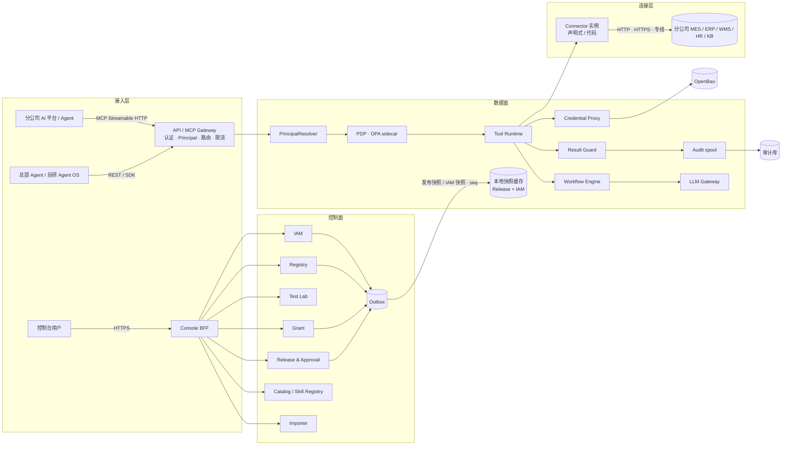
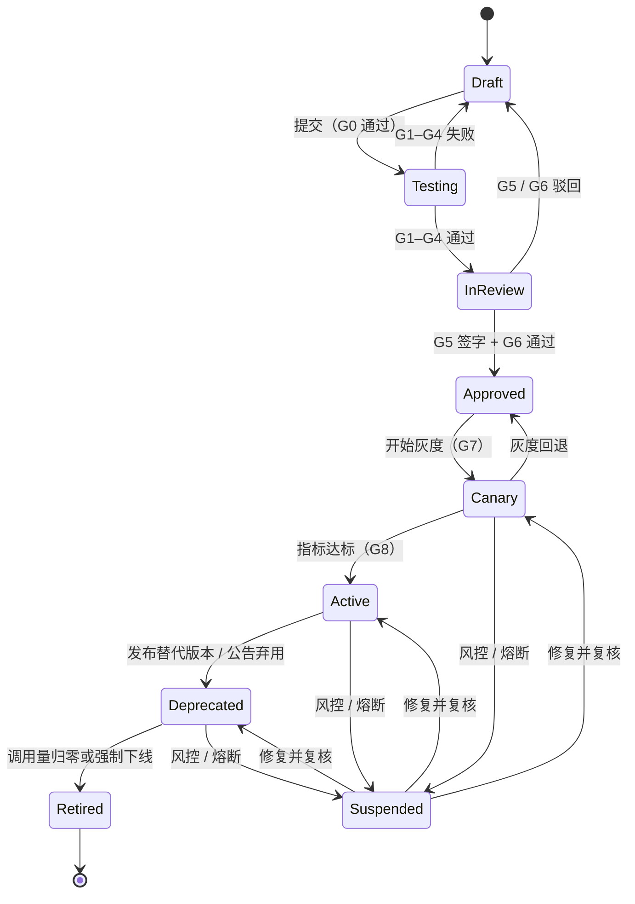
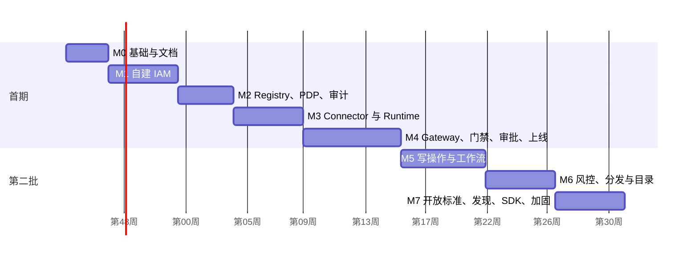

# 企业 AI 资产管理中台 架构设计 v0.4（完全自建 · 落地版）

2026-10-19 · v0.4.1 · 基于 v0.3（2026-10-16）审核修订；v0.4.1 移除跨境合规内容（ADR-0025） · 本文档是 docs/architecture.md 的唯一设计依据

## 0. 修订说明与结论速览

v0.3 确定了“平台自建身份、组织、密级与授权”的方向；v0.4 不改方向，只做一件事：**把它改到能直接开工、能按里程碑验收**。改动来自三方面：对 v0.3 的逐章审核、MCP 2026-07-28 新规范、对 GitHub 上同类项目（IBM ContextForge、agentgateway、Archestra、Preloop、iFlytek SkillHub 等）的对照。审核细节见《v0.3 审核报告与 v0.4 变更说明》。

**可行性结论**：可落地。治理核心必须自建（没有开源项目同时具备自建组织密级、授权上限下放、发布门禁与验收签字、写操作对账补偿）；协议层严格对齐 MCP、Agent Skills、A2A、OAuth 标准；网关、Mock、评测、扫描等局部借鉴开源实现。首期 M0 至 M4 参考工期 24 至 28 周、6 至 8 人。

| 变更项 | v0.3 | v0.4 |
| --- | --- | --- |
| MCP 规范 | 按 2025-11-25 有状态会话设计 | 同时支持 2025-11-25 与 2026-07-28（无状态、`server/discover`、tasks 扩展、`cacheScope`），见 10.1 |
| 用户断言 | 仅 X-User-Assertion 每次调用携带 | 推荐 RFC 7523 JWT Bearer 换平台短期令牌（与 MCP Enterprise-Managed Authorization 同标准），兼容保留请求头模式；发布 RFC 9728 元数据，见 3.1 |
| 写操作确认 | 只有 confirm\_policy 枚举 | 新增确认与审批流（confirmation 对象、三种确认通道、同一用户再签名），见 4.5 |
| PDP 数据 | OPA 持有全量 IAM 快照 | PrincipalResolver 预计算事实放入 input，OPA 只持策略，bundle 分发，见 4.4 |
| 审计 | 同步写 + 全局哈希链 | 本地持久化 spool + 分片哈希链 + 定时锚定签名，见 12.4 |
| Connector | 全部代码实现 | 新增声明式 REST Connector；Connector 独立打包、版本化、隔离，见 9.1、9.7 |
| TLS | 五种模式与护栏 | 补齐实现约束（握手后、请求前校验指纹；手动主机名校验；防 DNS 重绑定；下游 mTLS），并给出连接测试矩阵，见 9.6、附录 B |
| 资产类型 | Tool、Skill、Workflow | 增加内部资产 prompt、model\_profile，见第 6 章 |
| 门禁 | G0 至 G8 | G0 增加描述与 Skill 安全扫描；G2 增加工具选择评测；上线后合成探针检测契约漂移，见第 7 章 |
| 数据流护栏 | 只标记“不可信” | 新增套件组合约束与 Run 污点标记，见 8.7 |
| 组件选型 | Vault、Redis、MinIO | OpenBao、Valkey、SeaweedFS（或 Ceph RGW），接口兼容，见 13 章 |
| 表名 | user | iam\_user（user 是 PostgreSQL 保留字） |
| 里程碑 | 路线图图片（导出后丢失） | M0 至 M7 文字表，每个里程碑对应提示词与验收；**P3 与 M3 验收明确为 HTTP、自签 HTTPS 的 pinned 与 insecure 三种连接测试通过** |
| 一致性 | ADR 0001 至 0016 另加 0017；指标校准 M2 / M3 两种说法 | ADR 统一 0001 至 0025；非功能指标统一在 M4 后校准 |

**保留不变**：Asset / AssetVersion / Release 三层模型、版本不可变、状态机与 G0 至 G8；控制面与数据面分离与快照；统一执行链；五方交集默认拒绝；授权上限与下放；Tool 执行语义（幂等、对账、补偿、错误分类）；总部集中治理、分公司只调用。

## 1. 背景、目标与原则

本平台是旧系统与各类 Agent 之间的“转换插头”加资产治理底座，部署在总部信息中心机房，是一个与现有任何系统都不共享账号、部门、权限和数据库的独立系统。

**背景**：集团有多个分公司与工厂（中国、越南、柬埔寨），各自运行 MES、ERP、WMS、HR、OA 等系统，多数不支持 MCP，也不再投入开发。各分公司有自己的 AI 工作平台，总部也需要跨公司的 Agent。资产（Tool、Skill、Workflow Agent）由总部 IT 与开发集中创建和治理，分公司只调用，并在总部授予的上限内下放权限。

**目标**

- G1 统一资产：Tool、Skill、Workflow Agent 统一建模、版本化、发布、下线。
- G2 质量先行：测试与业务验收通过才能上架，上架后行为稳定、流程不变。
- G3 严格管控：发布要审核，开放要审批，使用要申请，按组织与密级隔离。
- G4 统一执行：内部调用与 MCP 对外暴露走同一条执行、权限、审计链路。
- G5 可观测可恢复：全链路追踪、风险检测、熔断、补偿与人工介入。
- G6 可扩展：新系统、新节点类型、新审批策略以插件方式接入，不改核心。
- G7 自主可控：身份、组织、密级、授权全部由本平台定义和维护；基础组件优先选择开源许可清晰、可自托管的实现。
- G8 交付效率（新增）：一个有 OpenAPI 文档的只读接口，从接入台账到上架 stable 不超过 5 个工作日（不含业务验收排期）。

**非目标（首期）**：不做通用低代码平台；不替代分公司的 Agent 平台；不改造旧系统（确需加幂等键等小接口，走 ADR-0010）；不做模型训练与托管；不接管旧系统的用户与权限管理；不与外部组织架构做实时同步；不做数据出境合规设计（集团已另行解决，ADR-0025）。

**约束**：Python 后端；PostgreSQL；平台部署在总部机房，经专线直连分公司机房里的系统；旧系统默认不改造；跨时区（UTC+7、UTC+8）、多语言（中文、越南语、高棉语、英文）。

**非功能目标（初始建议值，M4 后压测校准）**：网关可用性 ≥ 99.9%；平台自身附加延迟 P95 ≤ 100ms（不含下游，不含 LLM 节点）；审计零丢失；Gateway 与 Worker 无状态，可水平扩展；用户停用与授权撤销 30 秒内全局生效。

**设计原则**

1. 平台是身份与权限的唯一权威：外部系统声称的组织、角色、密级不被信任，也不被读取。
2. 控制面与数据面分离：治理故障不影响调用，治理变更不阻塞调用。
3. 已发布版本不可变：任何变更都发新版本并重新过门禁。
4. 流程由引擎强制执行，不靠提示词约束。
5. 默认拒绝，权限取多方交集。
6. 一切可审计、可追溯、可回放。
7. 面向接口扩展，核心保持小。
8. 旧系统是脆弱资源，必须被保护（限流、熔断、隔离）。
9. 协议跟随标准（新增）：对外协议只用公开标准并跟随其版本；私有扩展只放在标准预留的扩展位（如 `_meta`、`metadata`）。

## 2. 自建组织与用户模型

平台用一棵自己维护的 org\_unit 树表达集团、分公司与部门，用户、角色、密级、数据范围都挂在这棵树上，所有编码由本平台定义，不引用任何外部系统的部门或员工编码。

### 2.1 组织树 org\_unit

| 字段 | 说明 |
| --- | --- |
| id | 内部 UUID，永不改变；授权、数据范围一律按 id 引用 |
| type | group（集团根，唯一）/ company / department / team |
| code | 平台内唯一业务编码，如 VN01、VN01-MFG；可改名 |
| parent\_id、path | 父节点与物化路径（ltree），用于子树查询；深度不超过 6 层 |
| default\_clearance | 该节点下成员的默认密级，缺省沿树向上继承 |
| company\_id | 所属 company 节点 id，冗余存储，用于租户隔离与 RLS |
| timezone、locale、work\_calendar\_id | 公司级时区、默认语言、工作日历（审批 SLA 与通知使用），下级缺省继承 |
| status、valid\_from、valid\_to | 启用、停用、有效期 |

节点迁移、合并、停用写领域事件与审计；授权按节点 id 记录，迁移后随子树生效，停用节点后其下授权失效。组织闭包（祖先、后代集合）由 iam 模块维护在 org\_closure 表中，随 IAM 快照下发，数据面不在请求时递归计算。

### 2.2 用户 iam\_user

同一张表覆盖能登录控制台的人（管理员、开发者、审批人、验收人）和仅被消费方代表调用的员工（终端用户），由 login\_enabled 区分，后者没有密码。

- 基本字段：login\_name、display\_name、employee\_no（平台内唯一，可选）、email、timezone、locale、status（active / disabled / left）、valid\_from、valid\_to、last\_seen\_at。
- 归属：一个主归属节点 home\_org\_id，可有多个兼任（user\_org\_membership）。
- 创建方式：控制台手工创建，或批量导入（CSV、管理 API）。导入是“推送”，导入后平台为准，不回读、不对账。导入支持 dry-run 预览差异，按批次可回滚。
- 离职与调动由公司管理员在平台内操作。兜底规则（新增）：user\_binding 带到期日（默认 1 年，到期前提醒公司管理员复核）；终端用户连续 90 天无调用自动转为 disabled，再次使用需公司管理员恢复。
- **紧急访问账号（新增）**：平台预置 2 个 break-glass 管理员账号，密码与 TOTP 种子分段离线保管，登录即触发最高级告警，会话 1 小时，事后必须复盘。

### 2.3 数据范围 data\_scope

用户的有效数据范围 = 其所有归属节点的子树并集，再加管理员额外授予的节点（user\_data\_scope）。Tool 通过 scope\_binding 声明哪些入参对应组织维度（如 factory\_id 对应 company，dept\_id 对应 org 节点），PDP 在调用前校验入参值是否落在用户的数据范围内。

scope\_binding 的入参值必须能映射到 org\_unit：Tool Spec 中声明映射方式 `by_id`（入参就是 org\_unit id）或 `by_code`（入参是旧系统编码，经 org\_external\_code 表映射，如 VN01 工厂在 MES 中的编码 F001）。org\_external\_code 只是“平台节点到旧系统编码”的字典，由管理员维护，不代表信任旧系统的组织结构。

默认值：终端用户默认范围为其主归属部门子树；公司管理员可扩大到本公司；跨公司范围只有总部可授予。

判定规则（M2 实现）：dimension=org 时，入参映射到的节点必须在用户数据范围内；dimension=company 时，入参必须映射到公司节点，且用户数据范围内至少有一个节点属于该公司（例如车间员工可以查询本厂工单，但不能查询他厂）。绑定了组织维度的入参缺失或无法映射，一律视为越界。

### 2.4 密级 clearance

四级：L1 公开、L2 内部、L3 敏感、L4 机密，资产 data\_classification 使用同一刻度。

- 用户有效密级 = clearance\_override（未过期）；没有则取最近祖先节点的 default\_clearance；都没有则为 L1。
- 提升密级必须走申请，由数据 Owner / 安全岗审批，带到期日，全程审计。分公司管理员不能修改密级。批量提升（一次超过 10 人）需双人复核。
- 消费方应用有密级上限 clearance\_cap，调用时有效密级取用户密级与应用上限的较小值。

### 2.5 角色

| 角色 | 所在 | 能做什么 |
| --- | --- | --- |
| 平台管理员 | 总部 | 全局策略、授权上限、组织树、熔断、平台运维 |
| 资产开发者 | 总部 | 创建与测试资产、为所有公司维护 Connector（跨公司生效的总部角色）；不能审批自己提交的资产 |
| 数据 Owner / 安全 | 总部 | 审核密级、开放范围、写操作风险、传输例外；审批密级提升 |
| 业务 Owner | 总部或分公司 | 定义验收标准并签字验收（G5） |
| 分公司管理员 | 分公司 | 仅限本公司子树：维护部门与用户、绑定消费方用户、在授权上限内下放授权、到期复核 |
| 审批代理人（新增） | 任意 | 由审批人在休假期间指定，带有效期，代理期间的审批记录同时写明代理关系 |
| 审计员 | 总部 | 只读审计与报表，可导出审计报表 |

角色分配记录在 user\_role（用户、角色、生效节点、到期日）。所有管理操作按生效节点做范围检查。**高危 IAM 操作双人复核**：修改授权上限、批量密级提升、新增平台管理员、修改消费方 clearance\_cap、开启 by\_employee\_no 绑定策略。

### 2.6 租户隔离

一个平台实例对应一个集团。业务表带 company\_id 并启用 PostgreSQL RLS；跨公司可见性只通过 Release 开放范围与 Grant 表达。总部资产的 company\_id 为总部公司节点。

RLS 落地约束（新增）：

- 应用每个事务开始时执行 `SET LOCAL app.company_ids = '...'`（当前操作者可见公司集合）与 `SET LOCAL app.actor_id`，RLS 策略读取这两个设置；与 PgBouncer 事务模式兼容。
- 迁移与运维使用 owner 角色；总部跨公司报表使用独立的 BYPASSRLS 只读角色，仅审计员与平台管理员可用，查询全部审计。
- 每张业务表的 RLS 策略有自动化测试：用 A 公司身份查不到 B 公司数据。

## 3. 身份与认证

平台自己签发和校验全部凭据，识别三类主体：控制台用户、消费方应用、被消费方代表的终端用户。认证只回答“你是谁”，能做什么永远由平台的授权数据决定。

| 主体 | 认证方式 | 要点 |
| --- | --- | --- |
| 控制台用户 | 用户名 + 密码 + TOTP（默认）；可选 OIDC / SAML 插件 | 外部登录只经 external\_login 绑定到内部用户，不读取外部返回的组织、角色、密级 |
| 消费方应用 | ① OAuth 2.1 client\_credentials（private\_key\_jwt，推荐）② 静态 API Token（兼容）；可选 mTLS 绑定 | 静态令牌哈希存储、仅创建时显示一次、带有效期与来源 IP 绑定、可轮换吊销 |
| 终端用户（OBO） | ① RFC 7523 JWT Bearer 换平台访问令牌（推荐）② X-User-Assertion 每次携带（兼容） | 断言由消费方登记的私钥签名，平台验签后经绑定表映射为内部用户 |

### 3.1 用户断言与令牌交换

消费方的 AI 平台认识它的员工，平台不认识。消费方为每次调用声明“代表谁”，并用登记的私钥签名，平台验签后去绑定表查内部用户。

**断言格式**（两种模式通用）：JWT，ES256 或 RS256，头部带 kid；claim：iss（消费方 client\_id）、sub（员工在消费方侧的标识）、aud（平台令牌端点或平台 MCP 资源 URI）、iat、exp（不超过 5 分钟）、jti；可选 act\_agent（消费方内部 Agent 名，对应 agent\_profile）。

**模式 A：令牌交换（推荐）**

1. 消费方用 client\_credentials 或 private\_key\_jwt 认证自己，同时把用户断言作为 `assertion` 提交到 `POST /oauth/token`，`grant_type=urn:ietf:params:oauth:grant-type:jwt-bearer`，`resource=https://mcp.<域名>/mcp`（RFC 8707）。
2. 平台验签、检查 jti、查 user\_binding，签发平台访问令牌：有效期 5 至 15 分钟，claim 只有 sub（内部 user\_id）、act.sub（client\_id，RFC 8693 act 语义）、aud（资源 URI）、agent\_profile、exp、jti。不签发刷新令牌。
3. 消费方用该令牌调用 MCP 或 REST；令牌可在有效期内跨多次调用复用。

好处：验签与绑定查询每 5 至 15 分钟一次而不是每次调用；标准 MCP 客户端只需要配置一个 Bearer；与 MCP 官方 Enterprise-Managed Authorization 扩展（RFC 8693 + RFC 7523）同一套机制，未来消费方接入企业 IdP 时可平滑升级。

**模式 B：请求头断言（兼容）**：请求同时带应用凭据与 `X-User-Assertion`，每次调用验签。适用于消费方暂时改不动令牌获取逻辑的情况。注意：每个请求必须是新签的断言（jti 防重放），而 MCP 客户端会在每个请求上复用同一组头，因此 **MCP 接入只能用模式 A**（M4 实测确认）。

**防重放**：jti 在 Valkey 中保存至 exp；Valkey 不可用时退化为进程内缓存，并把可接受的断言剩余有效期收紧到 60 秒；退化期间模式 B 的写操作调用一律拒绝（模式 A 已签发的令牌不受影响）。

**公钥管理**：消费方注册时登记 JWKS（支持多把并行轮换），或登记 JWKS URL（仅限内网，平台按 1 小时缓存）。紧急吊销某把公钥后 30 秒内生效。

**绑定**：user\_binding（consumer\_id、external\_subject → user\_id、expires\_at）由分公司管理员维护，支持 CSV 导入。bind\_policy 由总部按消费方设置：

| 策略 | 行为 |
| --- | --- |
| strict（默认） | 必须预先绑定，未绑定的 sub 一律拒绝，错误码 USER\_NOT\_BOUND |
| by\_employee\_no | 用 sub 匹配本公司内的 employee\_no，首次匹配后自动写入绑定，需总部开启并双人复核 |
| app\_only | 不接受用户断言，所有调用以应用身份处理 |

不带用户身份的调用按应用身份处理：只命中授予消费方的 Grant，数据范围限于消费方所属公司，有效密级为 clearance\_cap。写操作与 danger 级别是否允许应用身份调用，由 Tool 的 identity 策略决定（默认不允许）。

**消费方接入包（新增）**：平台提供 Python、Java、TypeScript、.NET 四种语言的断言签名与令牌获取示例代码；控制台提供“断言调试器”（粘贴断言，显示验签结果、绑定结果、最终 Principal，不落日志），这是分公司联调最常用的工具。

### 3.2 Principal

认证完成后，网关在服务端解析统一的 Principal，后续 PDP 与审计都只认它：

```json
{
  "identity_kind": "user | app",
  "user_id": "u_123",
  "company_id": "c_VN01",
  "org_ids": ["org_group", "org_vn01", "org_vn01_mfg"],
  "roles": ["business_owner"],
  "clearance": 2,
  "data_scope_org_ids": ["org_vn01_mfg", "org_vn01_mfg_l1"],
  "client_id": "vn-ai-platform",
  "consumer_company_id": "c_VN01",
  "agent_profile_id": null,
  "auth_mode": "token_exchange | header_assertion | app_token | console_session",
  "iam_snapshot_seq": 18234
}
```

令牌里只放认证信息，不放组织、角色、密级；Principal 由数据面按 IAM 快照解析，所以组织调整与密级变更随快照生效。data\_scope\_org\_ids 是已展开的子树集合（来自 org\_closure），PDP 不再递归。

### 3.3 登录插件、MCP 授权元数据与服务间认证

- AuthProvider 是扩展点：local 为内置实现；OIDC、SAML 为可选插件，只验证身份并返回外部唯一标识，由 external\_login 映射到内部用户，找不到映射就拒绝登录。
- 平台对外发布 `/.well-known/oauth-protected-resource`（RFC 9728）与 `/.well-known/oauth-authorization-server`（RFC 8414），未认证请求返回 401 与 `WWW-Authenticate` 指向元数据，使标准 MCP 客户端可以自动发现令牌端点。首期令牌端点只支持 client\_credentials 与 jwt-bearer；authorization\_code + PKCE（给个人 MCP 客户端用）放到后做。
- 控制面、数据面、Worker 之间使用 mTLS 加短期服务令牌；平台内部令牌 audience 固定，不得转发给任何下游（禁止 token passthrough）。
- 调用旧系统时由 Credential Proxy 从 OpenBao 取下游凭据，模型与 Tool 都看不到明文。
- 审计同时记录 client\_id、end\_user\_id、agent\_profile\_id、auth\_mode。

### 3.4 账号安全基线

argon2id 密码哈希；所有可登录控制台的账号强制 TOTP（创建账号时生成种子，绑定 URI 只返回一次；可选 WebAuthn）；连续 5 次失败锁定 15 分钟并告警；会话 30 分钟滑动过期、最长 12 小时；静态 API Token 默认 90 天；平台签名密钥（访问令牌签名）存 OpenBao Transit，按季度轮换，JWKS 同时发布新旧两把；所有身份相关操作进入审计。

## 4. 授权模型

调用权限是五方交集，默认拒绝；管理权限与调用权限分开建模；判定所需数据全部来自本平台。

```
allow = Identity ∩ Grant ∩ ReleaseScope ∩ Classification ∩ RiskPolicy
```

| 方 | 判定内容 | 数据来源 |
| --- | --- | --- |
| Identity | 角色满足 required\_scopes；调用参数落在用户 data\_scope 内（scope\_binding） | iam\_user、user\_role、org\_closure |
| Grant | 消费方（或其 Agent Profile）有未过期授权，且在所属公司授权上限之内 | grant、grant\_ceiling |
| ReleaseScope | 被调用版本在对应环境、渠道、开放范围内已发布且未 Suspended | release、release\_snapshot |
| Classification | 有效密级 ≥ 资产 data\_classification | iam\_user、org\_unit、consumer |
| RiskPolicy | write / danger 按 confirm\_policy 触发确认或审批；传输例外连接上的写操作额外限制 | Tool Spec、risk\_policy、system\_connection |

PDP 的输出不是布尔值，而是三态加原因：`allow`、`deny(reasons[])`、`require_confirmation(kind=user_confirm|approval)`。

### 4.1 授权上限与下放

总部给每个分公司设授权上限 grant\_ceiling，分公司管理员只能在上限内下放，不能超出，也不能转授其他公司。

- 授权上限 = 可用资产集合（显式清单或按业务域）+ 最大密级 + 配额。
- 下放的授权写入 grant，记录 grantor 与 ceiling\_id；PDP 校验“授权 ⊆ 上限”；总部收缩或撤销上限时下游授权自动失效（快照生成时计算，不依赖级联删除）。
- 到期复核：分公司管理员执行，总部抽查。复核以“复核活动”（access\_review\_campaign）形式发起，列出到期授权与 90 天内未使用的授权，未在截止日前确认的自动失效。
- 分公司只能授予“可调用”；confirm\_policy 只能加严不能放宽。

### 4.2 授权对象与两层判定

grant 用 `grantee_type`（consumer / agent\_profile / org\_unit / user）与 `grantee_id` 表达对象，唯一约束为（asset\_id、grantee\_type、grantee\_id、env）。

1. **应用层**：必须存在授予该消费方或其 Agent Profile 的未过期 Grant。
2. **用户层（可选收窄）**：若对该资产设置了授予 org\_unit 或 user 的 Grant，终端用户必须命中其中之一；没有设置则不收窄。

应用身份只经应用层判定。

### 4.3 控制面 RBAC

管理权限按 2.5 角色收敛，所有控制面接口按“角色 + 生效节点”做范围检查。强制职责分离：开发者不能审批自己提交的资产；同一人不能同时是同一资产版本的提交人与验收人；danger 级别发布、传输例外的生产启用需双人复核。控制面 RBAC 用应用内的权限装饰器实现并有表驱动测试，不经 OPA（降低耦合，OPA 只做数据面调用决策）。

### 4.4 PDP 部署与数据分发

- PDP 用 OPA，sidecar 部署在数据面；rego 与表驱动测试同仓库，CI 跑 `opa test` 与覆盖率。
- **事实预计算**：PrincipalResolver（Python）根据 IAM 快照算好 Principal、命中的 Grant 列表、上限校验结果、scope\_binding 映射后的 org id，放入 PDP input；OPA 只持有策略与少量静态数据（风险策略表、密级刻度）。这样 OPA 内存与快照大小无关，策略也更容易测试。
- 策略随发布快照一起分发（`payload.policy` = 模块源码 + revision 摘要，与快照同一签名），数据面验签后推送到 OPA sidecar；数据面启动时没有有效策略则不就绪、调用全部拒绝。PDP 的放行只在全部检查“正向成立”时发生，字段缺失或类型错误一律拒绝。
- 身份与授权数据由控制面打成带 seq 的 IAM 快照（全量 + 增量），经 outbox 事件推送数据面；数据面写入本地只读缓存（进程内 + 本地文件），发现 seq 缺口主动拉取。控制面宕机时按已有快照服务；快照缺失或校验失败时 fail closed。
- 紧急变更（用户停用、授权撤销、上限收缩、公钥吊销）走高优先级通道，目标 30 秒内生效（M4 压测校准）。
- OPA decision log 关闭远程上报，由数据面把决策结果与原因写入审计。

PDP 输入示例：

```json
{
  "principal": {"identity_kind": "user", "user_id": "u1", "company_id": "c_VN01", "clearance": 2,
                "roles": [], "client_id": "vn-ai-platform", "agent_profile_id": null},
  "facts": {"app_grant": true, "user_grant_required": false, "user_grant": null,
            "within_ceiling": true, "scope_check": {"factory_id": {"org_id": "org_vn01", "in_scope": true}}},
  "resource": {"capability_id": "production.mes.query_work_orders", "version": "1.2.0", "classification": 2,
               "risk": "read", "release_status": "active", "confirm_policy": "auto",
               "transport_exception": false},
  "context": {"env": "prod", "channel": "stable", "exposure": "mcp", "time_utc": "2026-10-19T02:00:00Z"}
}
```

### 4.5 确认与审批流（新增）

当 PDP 返回 `require_confirmation`，Runtime 不执行 Tool，而是创建 confirmation 对象并返回 `status=pending_confirm`。

| 字段 | 说明 |
| --- | --- |
| confirmation\_id | 唯一 id |
| kind | user\_confirm（由被代表用户本人确认）/ approval（由审批人审批） |
| execution\_ref | 冻结的调用内容：capability、version、参数摘要与参数哈希、principal |
| summary | 面向人的确认文案，由 Tool Spec 的 confirm\_template 渲染，不由模型生成 |
| expires\_at | user\_confirm 默认 10 分钟，approval 默认按 SLA 日历 1 个工作日 |
| status | pending / confirmed / rejected / expired / executed |

确认通道（按优先级）：

1. **MCP 交互式确认**：客户端声明支持 elicitation（2025-11-25）或 MRTR `input_required`（2026-07-28）时，平台返回确认请求，用户在客户端点确认后，客户端重试原请求并带上确认结果。
2. **消费方回调确认**：消费方调用 `POST /confirmations/{id}/confirm`，必须携带**同一用户的新断言**（jti 不同、iat 晚于 confirmation 创建时间），平台核对 user\_id 与参数哈希一致后执行。
3. **平台待办**：用户或审批人在平台控制台（或 Notifier 推送的链接）确认，适用于 approval 与无法交互的客户端。

规则：确认后执行的参数必须与冻结内容逐字节一致；同一 confirmation 只能执行一次（幂等键 = confirmation\_id）；模型不能代替用户确认（应用身份不能确认 user\_confirm）；所有确认动作进审计。

## 5. 总体架构



控制面负责治理，数据面负责运行，二者只通过发布快照与 IAM 快照这一条单向事件通道协作；数据面不读控制面的业务表，控制面宕机时数据面按已有快照继续服务。

### 5.1 控制面与数据面的协作

每次发布生成 Release Snapshot（资产版本、Spec、依赖锁、开放范围、策略版本），身份与授权变更生成 IAM 快照，二者经 outbox 事件推送给数据面并带递增 seq。数据面本地缓存并校验 seq 与签名，发现缺口主动拉取；快照缺失或损坏时按 4.4 默认拒绝。首期事件通道用 PostgreSQL outbox + LISTEN/NOTIFY + 拉取兜底，不引入消息队列；Gateway 实例超过 20 个或跨机房时再评估 NATS（ADR-0019）。

### 5.2 模块职责

| 模块 | 面 | 职责 |
| --- | --- | --- |
| API / MCP Gateway | 接入 | 认证、令牌端点、受保护资源元数据、路由、按 Principal 暴露 MCP 工具、限流 |
| IAM | 控制 | 组织树、用户、角色、密级、消费方、用户绑定、授权上限；身份与授权数据的唯一写入方 |
| Registry | 控制 | 资产、版本、依赖、发布快照 |
| Importer | 控制 | 解析 OpenAPI / Postman 生成声明式 Connector 与 Tool 草稿；AI 生成候选描述 |
| Test Lab | 控制 | 用例库、沙箱、Mock、回放、稳定性与选择评测 |
| Release & Approval | 控制 | 状态机、门禁、审批流、灰度、回滚 |
| Grant | 控制 | 开放范围、授权上限、使用申请、下放、复核活动 |
| Catalog / Skill Registry | 控制 | 目录发现、Skill 包与套件分发 |
| PrincipalResolver | 数据 | 按 IAM 快照解析 Principal、预计算授权事实 |
| PDP | 数据 | OPA 策略决策 |
| Tool Runtime | 数据 | 校验、确认、限流熔断、重试幂等、对账、结果处理 |
| Workflow Engine | 数据 | 按 DSL 执行流程、人工任务、补偿 |
| LLM Gateway | 数据 | 统一模型调用、版本锁定、预算、脱敏 |
| Credential Proxy | 数据 | 下游凭据获取与会话管理 |
| Connector | 连接 | 对接旧系统，声明式或代码插件 |
| Probe Scheduler | 数据 | 合成探针、连通性与契约漂移检测 |
| Audit & Risk | 横切 | 审计、风险检测、告警、熔断 |

## 6. 资产模型

所有资产共用一套抽象：Asset → AssetVersion → Release。

| 资产类型 | 对外 | 说明 |
| --- | --- | --- |
| tool | 是 | 单步能力 |
| skill | 是 | 指令包，安装到消费方平台 |
| workflow | 是 | 固定流程的 Agent，对外是异步 Tool |
| bundle | 是 | 套件，按场景打包 Tool |
| prompt（新增） | 否 | 提示模板，被 workflow 的 llm 节点引用 |
| model\_profile（新增） | 否 | 模型配置：供应商、模型名与版本、温度、最大 token、结构化输出模式 |
| connector\_package（新增） | 否 | Connector 代码包或声明式映射文件，见 9.7 |

- **Asset**：稳定标识、类型、归属组织节点、负责人、数据密级。
- **AssetVersion**：不可变，语义化版本号、内容哈希、Spec、依赖锁。
- **Release**：某个版本在“环境 × 范围 × 渠道”上的发布实例。环境 test / staging / prod；范围按 org\_unit id 或 consumer id；渠道 beta / stable；exposure 为 rest / mcp / a2a 子集，默认只有 rest。

### 6.1 Tool Spec

| 字段 | 说明 |
| --- | --- |
| capability\_id / domain | {domain}.{system}.{action}，如 production.mes.query\_work\_orders |
| name / title / description | 面向模型的名称与描述，是审核对象；description 必须是一种规范语言（默认中文，按套件可配英文），另有 title\_i18n 给人看 |
| usage\_notes / not\_for / examples | 用途、前置条件、不适用场景、调用示例（进入选择评测） |
| input\_schema / output\_schema | JSON Schema 2020-12，入参出参契约 |
| connector\_ref + 映射 | 绑定的 Connector 实例类型与 operation，请求映射、响应裁剪、classify 规则 |
| output\_limits（新增） | 最大返回条数、最大字节、分页方式（cursor），超限截断并返回 next\_cursor |
| risk\_level | read / write / danger |
| idempotency | 是否幂等，幂等键生成规则 |
| timeout | connect / read / deadline |
| retry\_class、rate\_limit、breaker | 重试策略映射、限流、熔断 |
| reconcile / verify | 写操作结果未知时的只读对账方式；执行后确认业务结果的方式 |
| recovery、compensation\_ref | none / retry / compensate / manual；补偿 Tool |
| identity\_mode | service\_account / user\_delegated / hybrid，见 9.3 |
| scope\_binding | 入参到组织节点的映射，by\_id 或 by\_code |
| data\_classification、required\_scopes | 数据密级、所需角色 |
| pii\_fields（新增） | 出参中的个人数据字段路径，Result Guard 按密级与调用方有效密级脱敏 |
| confirm\_policy、confirm\_template | auto / user\_confirm / approval；确认文案模板 |
| app\_identity\_allowed（新增） | 是否允许应用身份调用，write 与 danger 默认 false |
| probe（新增） | 合成探针：只读调用参数、频率（默认每小时）、期望断言；write 类 Tool 用其 reconcile 查询做探针 |
| egress\_class（新增） | none / internal / external：该 Tool 是否会把数据发出集团边界（邮件外发、外部 API），用于 8.7 |

### 6.2 Skill Spec

标准 Agent Skills 目录（SKILL.md + 可选 references/、assets/），frontmatter 遵循规范（name、description、可选 license、compatibility、metadata、allowed-tools）。平台私有信息（引用的 Tool@版本、验收单编号、渠道）放在 metadata 或同目录 skill.lock.json。Skill 不直接执行，验收重点是“指导效果”，用评测集衡量。默认只发指令型 Skill，不带脚本。

### 6.3 Workflow Agent Spec（DSL）

- 输入与输出 Schema、触发方式（API、定时、事件）。
- 节点类型：tool（锁定版本）、llm（引用 prompt@版本 与 model\_profile@版本，结构化输出，只产出数据，不能改变流程）、condition（基于数据的确定性分支，表达式用 CEL 子集）、parallel、loop（必须有上限）、human\_task（确认 / 审批 / 补录）、sub\_workflow、wait、end。
- 全局约束：总超时、预算（最大步数、LLM 调用数、token）、错误处理（重试 → 补偿 → 升级人工）。
- 依赖锁：所有 Tool、子流程、提示模板、模型配置版本全部固定。

```json
{
  "name": "purchase_order_review", "version": "1.0.0",
  "budget": {"max_steps": 30, "max_llm_calls": 3, "timeout_s": 600},
  "nodes": [
    {"id": "n1", "type": "tool", "ref": "finance.erp.get_po@1.2.0", "next": "n2"},
    {"id": "n2", "type": "llm", "model_profile": "mp_extract_v1@1.0.0", "prompt": "po_risk_extract@3.0.0",
     "output_schema": "RiskFlags", "next": "n3"},
    {"id": "n3", "type": "condition", "expr": "n2.risk_level == 'high'", "then": "n4", "else": "n5"},
    {"id": "n4", "type": "human_task", "kind": "approve", "assignee": "role:purchase_manager@org_of(input.company)", "next": "n5"},
    {"id": "n5", "type": "tool", "ref": "finance.erp.approve_po@1.0.1",
     "compensation": "finance.erp.revoke_approval@1.0.0", "next": "end"}
  ]
}
```

静态校验：无环、可达、loop 有上限、预算有界、所有 ref 版本已锁定、写节点带补偿或标记不可逆、human\_task 的 assignee 可解析。DSL 内部格式，不对消费方暴露；编辑方式是 YAML / JSON + 校验 + 只读流程图预览（不做拖拽画布）。

### 6.4 依赖图与影响分析

Workflow → Tool@版本 / prompt@版本 / model\_profile@版本，Skill → Tool@版本，Bundle → Tool@版本，Tool → connector\_package@版本。任何节点发新版本时自动列出受影响的上层资产并触发回归测试；Connector 包升级视同其下所有 Tool 的依赖变更。

## 7. 生命周期与质量门禁



八个状态：Draft、Testing、InReview、Approved、Canary、Active、Deprecated、Retired；另有 Suspended 熔断态，只能回到进入前的状态（记录 suspended\_from）。状态迁移只能由门禁结果驱动，非法迁移抛错。

### 7.1 质量门禁

| 门 | 内容 | 通过条件 | 执行 |
| --- | --- | --- | --- |
| G0 静态检查 | Schema 合法、依赖可解析、敏感字段识别、DSL 校验；Skill 用 skills-ref validate；**描述与 Skill 安全扫描**（隐藏指令、零宽与同形字符、诱导越权措辞、外链） | 全部通过 | 自动 |
| G1 契约测试 | 调用测试环境或 Mock，校验入参出参、错误码映射、classify 规则 | 100% | 自动 |
| G2 功能测试 | Golden Set 逐条运行并断言；权限用例；**工具选择评测**（见 7.2） | 关键用例 100%；选择评测达阈值 | 自动 |
| G3 稳定性 | 同一用例重复 N 次（≥ 20），比对结果与执行路径 | 确定性节点 100% 一致，LLM 节点达阈值 | 自动 |
| G4 回归与影响 | 依赖变更触发上层全量回归 | 全部通过 | 自动 |
| G5 业务验收 | 业务 Owner 用真实样例验收并签署验收单 | 签字 | 人工 |
| G6 安全审核 | 密级、开放范围、写操作与补偿、身份模式、数据范围绑定、**连接传输方式**、egress\_class | 审批通过 | 人工 |
| G7 灰度 | 小范围运行，观察错误率、人工介入率、耗时 | 指标达标 | 自动 + 人工 |
| G8 全量 | 转 Active，设观察期与回滚预案 | 观察期无异常 | 自动 |

验收标准在 Draft 阶段写入验收单模板：目标场景、准确率、任务完成率、耗时、人工介入率。只读、低密级（L1 / L2）、无 PII 的 Tool 可走**快速通道**：G5 由业务 Owner 在线勾选确认，G6 由数据 Owner 单人审批，G7 灰度期缩短为 1 天，以满足 G8 交付效率目标。

### 7.2 Test Lab

- **测试模式**：沙箱（Connector 指向测试环境或 Prism Mock，写操作只在沙箱执行）；真实读（仅限生产只读接口，限流加脱敏，仅用于验收）；回放（脱敏历史调用回放，后做）。
- **Mock 自动生成**：有 OpenAPI 的系统用 Prism 起 Mock，用例可覆盖 Mock 响应；没有 OpenAPI 的用录制的脱敏响应。
- **用例属于资产**，随版本管理；含输入、前置数据、断言（精确、Schema、语义）和期望执行路径。
- **权限用例**：用例可声明测试 Principal（公司、部门、密级、应用身份），验证“该拒绝的确实被拒绝”，属于 G2 关键用例。
- **工具选择评测（新增）**：每个套件维护“自然语言问题 → 期望 Tool（或期望不调用）”评测集，至少 20 条，用消费方实际使用的 1 到 2 个模型跑，指标为 top-1 命中率与误调用率；新 Tool 加入套件或描述变更都重跑。阈值默认 top-1 ≥ 90%、误调用 ≤ 5%。
- **LLM 节点评估**：固定模型版本与温度、结构化输出、断言优先；语义质量由规则加评估模型打分，评估模型只作参考，以业务验收为准。评测执行可集成 promptfoo（配置文件随资产版本存储）。
- **稳定性指标**：结果一致率、路径一致率、延迟分布、失败率。

### 7.3 如何保证“上架后流程不变”

1. 版本不可变 + 内容哈希，Release 只引用版本。
2. 引擎按 DSL 强制执行，运行时校验每一次节点转移。
3. 消费方绑定 stable 渠道或固定版本，新版本不会静默替换。
4. 模型与提示模板版本锁定，更换即新版本。
5. 运行时漂移监测：线上抽样与验收基线比对，劣化告警（首期只告警）。
6. **契约漂移探测（新增）**：Probe Scheduler 按 Tool 的 probe 配置定时调用（只读、带 `X-Platform-Probe` 标记、计入该系统限流），连续 3 次失败或返回结构不符合 output\_schema 时，Tool 标记“契约漂移”、通知负责人并自动触发 G1 回归；不自动 Suspended，由负责人判断。

### 7.4 回滚与弃用

- Release 保留上一个稳定版本指针，可一键回退；运行中的实例钉住启动时的版本跑完，新调用走回退版本。
- Deprecated 至少公告 30 天，目录标记并通知订阅方；仍有调用的版本不得 Retired，要等调用量归零或总部强制下线并记录原因。

## 8. 执行引擎与 Tool Runtime

Agent 决定目标与下一步，工作流引擎可靠推进多步流程，Tool Runtime 负责单步安全执行；重试预算由 Runtime 控制。

### 8.1 统一执行链

认证 → 解析 Principal → 入参 Schema 校验 → PDP（allow / deny / require\_confirmation）→ 确认（4.5）→ 限流与配额 → Tool Runtime（幂等、超时、重试、熔断）→ Connector → classify / verify → Result Guard → 审计。MCP 与 REST 共用这条链；自研 Agent OS 与控制台走 REST / SDK。

### 8.2 统一执行结果与错误分类

```json
{
  "execution_id": "exec_01JABC...",
  "status": "succeeded | failed | unknown | pending_confirm | running | cancelled | compensated",
  "data": {},
  "page": {"next_cursor": null, "truncated": false},
  "error": {"code": "DOWNSTREAM_AUTH_EXPIRED", "message": "MES 认证已过期", "retryable": true},
  "next_action": {"type": "refresh_auth | fix_args | request_permission | confirm | wait | reconcile | ask_human",
                  "message": "...", "confirmation_id": null, "retry_after_s": null},
  "trace_id": "4bf92f3577b34da6a3ce929d0e0e4736"
}
```

| 类别 | 错误码示例 | 重试 | 处理 |
| --- | --- | --- | --- |
| 参数错误 | INVALID\_ARGUMENT、IDEMPOTENCY\_CONFLICT | 否 | 返回字段级原因 |
| 下游认证过期 | DOWNSTREAM\_AUTH\_EXPIRED | 刷新后最多 1 次 | Credential Manager 刷新 |
| 权限不足 | PERMISSION\_DENIED、USER\_NOT\_BOUND、OUT\_OF\_SCOPE | 否 | 提示申请授权 |
| 需确认 | CONFIRMATION\_REQUIRED | 否 | 返回 confirmation\_id |
| 限流 | RATE\_LIMITED | 有条件 | 遵守 Retry-After |
| 临时故障 | DOWNSTREAM\_UNAVAILABLE、DOWNSTREAM\_TIMEOUT | 读可；写仅幂等时 | 指数退避，受总预算限制 |
| 传输与证书 | TLS\_UNTRUSTED、TLS\_EXPIRED、TLS\_HOSTNAME\_MISMATCH、TLS\_PIN\_MISMATCH、TLS\_FINGERPRINT\_CHANGED、SCHEME\_MISMATCH、REDIRECT\_BLOCKED、TRANSPORT\_NOT\_ALLOWLISTED、TRANSPORT\_EXCEPTION\_EXPIRED | 否 | 熔断计数，提示连接负责人 |
| 业务规则冲突 | BUSINESS\_RULE\_VIOLATION | 通常否 | 返回业务原因 |
| 写操作结果未知 | OUTCOME\_UNKNOWN | 不直接重试 | 进入 unknown，对账 |
| 熔断或维护 | CIRCUIT\_OPEN、MAINTENANCE\_WINDOW | 否 | 返回预计恢复时间 |

对外错误信息统一映射，不泄露旧系统内部细节（主机、堆栈、SQL）。

### 8.3 超时、幂等与对账

- 超时三层：连接、读取、总期限（deadline 随上下文传递），执行超时必须小于调用方超时。
- 写类 Tool 必须带幂等键：调用方提供（Idempotency-Key 头或 MCP 参数 `_meta`），或由 Runtime 按 run / step 派生。唯一约束在 PostgreSQL（consumer + capability + key）；同键不同参数返回 IDEMPOTENCY\_CONFLICT。
- 写操作超时或连接中断记为 unknown，不自动重放；Runtime 按 reconcile 只读查询确认：已成功补记结果；确认未执行按幂等策略重试；仍不确定保持待确认并升级人工。对账任务由 Worker 异步执行，最多 N 次（默认 5 次，指数间隔）。
- 请求成功不等于业务成功：classify(response) 把“HTTP 200 但业务码失败”归为失败；Tool 可声明 verify。
- 每次执行写入 tool\_execution，输入输出只存脱敏快照或加密引用（信封加密，见 12.6）。

### 8.4 恢复层次

重试 → 补偿（用新的业务操作抵消，如取消、冲销、撤回）→ 人工恢复。单系统事务交给系统自己；跨系统用 Workflow Saga。

### 8.5 Workflow Engine

- 持久化执行：workflow\_run、step\_run（step journal）存 PostgreSQL；Worker 用 FOR UPDATE SKIP LOCKED 拉取；每步带幂等键，崩溃后按 journal 恢复；定时器（wait、human\_task 超时）由 timer 表 + 扫描实现。
- 预计 30 秒内完成的同步返回，其余返回 run\_id；结果经 MCP tasks 扩展（tasks/get 轮询）、get\_run\_status 工具、GET /runs/{id} 或 webhook 获取。
- human\_task 持久化，支持确认、审批、补录，带超时、升级与代理人；通知用 Notifier 插件（邮件 + 一个 IM）。
- Saga：写步骤声明 compensation\_ref，失败后逆序补偿；不可逆步骤必须前置人工确认。
- Run 启动时钉住 Release 快照。
- 实现选择（ADR-0003，已决策）：自研 step journal，接口抽象为 WorkflowExecutor。2026-10-20 的 spike 对比了 DBOS Transact，开源版不能自动接管消失的 Worker、恢复绑定应用版本、系统表无法纳入 RLS，故不采用；对比记录见 [docs/ops/spike-adr-0003-workflow-engine.md](ops/spike-adr-0003-workflow-engine.md)。Run 认领用租约（lease），租约过期任何 Worker 可接手。Temporal 仍不在首期。

### 8.6 LLM Gateway 与 Result Guard

- LLM Gateway：所有 llm 节点、Importer 生成、选择评测都经统一网关；后端只接 OpenAI 兼容协议（国内云模型、本地 vLLM 均可），按 model\_profile 固定模型版本与温度；结构化输出校验、token 预算（按公司、按资产）、输入脱敏、全量审计（提示与输出存加密引用）。按公司配置模型白名单（例如越南公司数据只能用指定部署位置的模型）。
- Result Guard：按 output\_schema 裁剪、按密级与 pii\_fields 脱敏、按 scope\_binding 过滤超范围数据、按 output\_limits 截断、包装为不可信数据（MCP 结果中以结构化内容返回，文本内容加明确的数据边界标记）后再交给模型；错误信息统一映射。

### 8.7 数据流护栏（新增）

外部 Agent 的推理过程平台控制不了，平台能控制的是“哪些能力被放在一起”和“平台自己运行的流程”。当一个 Agent 同时具备“读私有数据”“接触不可信内容”“对外发送”三种能力时，提示注入就能把数据带出去。对策：

1. **套件组合约束**：同一套件（以及同一消费方在发现模式下可见的集合）中，若同时含 L3 及以上的读 Tool 与 egress\_class=external 的 Tool，G6 必须显式批准并记录理由；默认拒绝发布这样的套件。
2. **Run 污点标记**：平台内 Workflow 运行时，任何来自旧系统自由文本字段、知识库文档、上游 MCP 的内容进入上下文后，Run 被标记 tainted；tainted 状态下后续 write / danger / egress 节点强制 human\_task 确认，不论原 confirm\_policy。
3. **MCP 结果标注**：返回给外部 Agent 的结果在 `_meta` 中带 `<集团反向域名>/untrusted: true`（如 `com.example-group/untrusted`，不使用 MCP 保留前缀） 与来源系统，便于消费方平台实施自己的防护。

## 9. Connector 与旧系统接入

所有 Connector 运行在总部机房，经专线直连各分公司系统；每个旧系统（包括知识库）都只是一个被保护的下游，平台不读取它的用户、部门或权限结构，也不要求它改动。

### 9.1 连接器类型

| 类型 | 适用 | 说明 |
| --- | --- | --- |
| 声明式 REST（新增，首选） | 有 REST API、逻辑简单的接口（预计 70% 到 80%） | YAML 映射，无代码；由 Importer 从 OpenAPI / Postman 生成草稿，开发者修改 |
| 代码 REST / SDK | 签名算法特殊、多步调用、复杂分页或 SOAP | 实现 Connector Protocol |
| 数据库只读 | 无 API 的读需求 | 只读副本或视图，模板化 SQL，护栏见 9.5 |
| 上游 MCP | 导入已有 MCP 能力 | 不可信来源：描述重新审核，固定版本与内容哈希 |
| 浏览器自动化（RPA） | 只有网页 | 最后手段，首期不做 |

声明式映射示例：

```yaml
connector: mes_vn01            # 绑定 connector_instance（决定 system_connection，即地址与 TLS）
operation: query_work_orders
request:
  method: GET
  path: /api/v2/workorders
  query:
    plant: "{{ scope.factory_id | external_code('mes') }}"   # org_unit → 旧系统编码
    status: "{{ args.status }}"
    pageSize: "{{ args.limit | default(50) | max(200) }}"
  headers: {Accept: application/json}
response:
  success_when: "$.code == 0"            # classify：HTTP 200 但 code != 0 视为失败
  data: "$.data.items[*]"               # JSONPath 裁剪
  fields: {wo_no: "$.woNo", qty: "$.planQty", status: "$.status"}
  next_cursor: "$.data.nextPage"
errors:
  - when: "$.code == 4011"  map: DOWNSTREAM_AUTH_EXPIRED
  - when: "$.code == 5003"  map: BUSINESS_RULE_VIOLATION
```

模板引擎使用沙箱化 Jinja2（禁止属性访问与任意函数，只开放白名单过滤器），所有值都做 URL 与头部编码，防注入。

写操作一律走 API 或存储过程，不直接写业务库；需要补偿的写操作同时交付补偿逻辑并在沙箱验证。每个 Connector 附“接入台账”：API 文档、库表说明、测试环境、负责人、已知限制、维护窗口、传输方式与证书情况。

### 9.2 旧系统保护与连接配置

- 按 connector\_instance 设并发上限、令牌桶、熔断、短 TTL 读缓存、写操作串行队列；限流同时按“系统 × 消费方”分配，避免一个消费方占满。
- 专线抖动由超时、熔断与读缓存兜底，并按“公司 × 系统”监测连通性（探针见 7.3）。
- system\_connection 记录：系统与环境、base\_url、scheme、TLS 策略（9.6）、认证模式、凭据引用、Token 策略、超时与并发、健康检查、维护窗口（按公司时区）、负责人。
- Credential Manager：Token 缓存并续期；刷新用 single-flight（进程内锁 + Valkey 分布式锁，锁不可用时退化为进程内）；遇 401 刷新后最多重试一次；无法自动刷新告警转人工；Token 永不进入模型上下文与日志。

| 老系统认证方式 | 处理 |
| --- | --- |
| 固定 API Key | OpenBao KV 存放，调用时注入 |
| Bearer Token | 缓存并按有效期续期 |
| OAuth 2.0 | 按授权模式获取与刷新，校验 scope |
| 用户名密码换 Token | 后端登录，按系统机制续期 |
| Cookie / Session | 会话管理器处理过期与重新登录 |
| HMAC / 自定义签名 | 代码 Connector 实现签名插件 |
| 验证码、动态验证 | 要求系统方提供服务账号或正式 API |

### 9.3 身份模式与下游账号映射

| 模式 | 适用 | 说明 |
| --- | --- | --- |
| service\_account | 后台自动化、低风险读（默认） | 系统方建专用最小权限账号；平台侧仍按第 4 章校验用户与数据范围 |
| user\_delegated | 个人数据、审批、高风险写 | 以用户身份调用目标系统，要求目标系统支持 |
| hybrid | 读用服务账号，写用用户身份 | 两者结合 |

user\_delegated 依赖 system\_account\_binding（user\_id、system\_connection\_id、external\_account）。涉及个人敏感数据或 danger 的 Tool 不得仅凭服务账号放行，必须叠加用户授权或审批。传输例外连接（http、insecure）上只允许 service\_account。

### 9.4 知识库作为普通系统接入

kb-connector 调用知识库现有开放接口，暴露为 kb.search、kb.get\_document 等 read 类 Tool，不共享身份、不要求改造。

- 可见范围由知识库服务账号决定，identity\_mode 固定为 service\_account；数据 Owner 评审该账号可见范围，按可见内容最高密级定级。
- 按公司隔离：每个分公司使用独立知识库账号，只覆盖该公司应开放的内容。
- 平台侧再收一道：Grant、数据范围、密级、Result Guard 仍然生效。
- 返回结果保留文档 id、标题、链接，便于 Agent 给出引用；正文按 output\_limits 截断。
- 知识库内容属于“不可信内容”，参与 8.7 污点标记。

### 9.5 数据库只读连接器护栏

- 只允许管理员登记的 SQL 模板（参数化），禁止拼接与任意 SQL。
- 使用只读账号连接只读副本或视图；会话级设置 statement\_timeout（默认 5 秒）与只读事务。
- 强制 LIMIT（默认 200，最大 1000）；登记时执行 EXPLAIN，估算成本超过阈值不允许发布。
- 结果列按 output\_schema 白名单返回。

### 9.6 下游传输与 TLS 信任

旧系统既有 HTTPS（含内部 CA 与自签证书），也有只支持 HTTP 的，平台都能接入：下游按连接配置传输方式与 TLS 策略，允许明文 HTTP 与不校验证书；对外则统一只提供 HTTPS。放开不等于不管，每个例外都要审批、限定范围、带到期日并全程审计。

**策略挂在连接上，不挂在 Tool 上**。Tool 版本不可变且跨环境复用，证书属于部署环境，所以 TLS 配置放在 system\_connection 与 upstream\_mcp\_source 上，Tool 经 connector\_ref 继承，Tool Spec 里没有 TLS 字段。

| scheme + tls\_mode | 做法 | 适用 |
| --- | --- | --- |
| https + system\_ca（默认） | 系统信任库校验证书链、有效期、主机名 | 公共 CA 证书 |
| https + custom\_ca | 信任管理员上传的内部根 CA（一份 CA 可被多个连接复用），完整校验 | 内部 CA 签发，首选 |
| https + pinned | 只信任指定指纹：cert（整证书 SHA-256）或 spki（公钥 SHA-256，证书续签但密钥不变时无需更新）；可登记多个指纹用于轮换 | 单个自签证书，推荐 |
| https + insecure | 不校验证书链与有效期；可选仍校验主机名；首次连接记录指纹，之后变化告警 | 拿不到 CA 也无法登记指纹的自签证书系统 |
| http | 明文，不做 TLS | 只支持 HTTP 的旧系统 |

推荐顺序 custom\_ca、pinned、insecure、http。自签证书用 pinned 同样能连通且仍能防中间人，只是首次要登记指纹；控制台“连接测试”可以一键取回指纹生成 pinned 草稿，所以 insecure 应当很少用。

**pinned 的证书有效期**：指纹匹配即确认身份，证书过期不阻断连接（自签证书常年不换）；到期前 30 天与过期后每天告警连接负责人。可按连接打开 `pin_enforce_expiry` 改为过期即阻断。

**下游 mTLS（新增）**：任何 https 模式都可额外配置客户端证书（client\_cert\_ref，私钥存 OpenBao），用于要求双向认证的系统。

**insecure 与 http 的护栏**

- 只能对单个 system\_connection 或 upstream\_mcp\_source 开启，不能全局或按 Tool 开启。
- 必须填写理由，由数据 Owner / 安全审批，带到期日（默认 90 天，到期前 14 天提醒，到期未复审则禁用该连接，调用返回 TRANSPORT\_EXCEPTION\_EXPIRED 并告警）。
- 目标地址必须落在内网网段白名单内：**按连接时实际解析出的 IP 判断**（不是按配置中的主机名），每次新建连接都检查，防 DNS 重绑定；公网地址不允许 insecure 与 http。
- 允许绑定 write 与 danger Tool，但属于高风险例外：G6 必须标注“传输不安全”，需数据 Owner 与安全双人复核，并建议在专线或网段上只放行平台出站地址。
- 这类连接只使用该系统专用最小权限服务账号，不使用个人账号，也不用 user\_delegated。
- insecure 首次连接记录服务端证书指纹，之后变化产生 TLS\_FINGERPRINT\_CHANGED 事件并告警；可按连接设置 `block_on_fingerprint_change`（生产 write 类连接默认开启）。
- 控制台在连接上显示“不校验证书”或“明文 HTTP”标记；每次出站日志带 transport、tls\_mode、tls\_verified、peer\_fingerprint 字段；所有变更写审计。
- 沙箱与 staging 连接可由开发者申请、数据 Owner 单人审批；生产连接需双人复核。

**实现约束**（已用 PoC 验证，见附录 C）

1. Connector SDK 提供唯一的出站 HTTP 客户端工厂 `build_client(connection)`，基于 httpx + httpcore；所有 Connector（含声明式）必须经它出站。CI 用 ruff 自定义规则与 grep 双重检查，禁止 `verify=False`、`ssl._create_unverified_context`、`CERT_NONE` 出现在工厂之外。
2. **pinned 与 insecure 的检查必须在 TLS 握手完成后、写入任何 HTTP 字节之前执行**：在 httpcore 自定义网络后端的 `start_tls()` 中取对端证书（`getpeercert(binary_form=True)`）计算指纹并比对，失败即关闭连接。不允许在拿到响应后再比对，否则 Authorization 等凭据已经发给了中间人。
3. Python ssl 不支持“CERT\_NONE 同时校验主机名”（设置会抛 ValueError），所以 insecure + 校验主机名由工厂用 cryptography 解析证书 SAN（DNS 与 IP）手动比对；pinned 模式不校验主机名（指纹已唯一确定对端）。
4. custom\_ca 用 `load_verify_locations(cadata=...)`，保持完整校验；自签证书也可以作为 custom\_ca 的信任锚（此时仍校验有效期与主机名）。
5. TLS 最低版本 1.2；连接池按 system\_connection 隔离，配置变更后旧连接池排空重建。
6. base\_url 的协议必须与 scheme 一致，否则拒绝（SCHEME\_MISMATCH）；`follow_redirects=False`，需要跟随重定向的接口由 Connector 显式处理，且禁止 https 到 http、禁止跨主机重定向。
7. httpx 会把自定义异常包装为 ConnectError，错误映射必须检查异常链（`__cause__`），映射为 TLS\_PIN\_MISMATCH、TLS\_HOSTNAME\_MISMATCH 等明确错误码，不能笼统成 DOWNSTREAM\_UNAVAILABLE。

**连接测试**：控制台与 API（`POST /connections/{id}/test`）执行一次真实握手与可选的健康检查请求，返回：解析出的 IP 与是否在白名单、协议与 TLS 版本、证书链、颁发者、有效期、cert 与 spki 两种指纹、SAN 与主机名是否匹配、按当前 tls\_mode 的判定结果和明确失败原因（证书不受信任 / 已过期 / 主机名不符 / 指纹不符 / 明文被拒）。提供“信任此 CA”和“固定此证书”按钮，生成 custom\_ca 或 pinned 配置草稿，经审批后生效。连接测试本身不携带凭据（健康检查请求可选是否带凭据，pinned 与 system\_ca / custom\_ca 校验通过后才会带）。

**对外统一 HTTPS**：平台 MCP、REST 与控制台只监听 HTTPS（TLS 1.2 及以上，建议 1.3），不开放 HTTP 端口，也不做 http 到 https 跳转；开启 HSTS。对外证书由集团内部 CA 签发，分公司平台连接时若报证书不受信任，应让客户端安装根 CA，而不是关闭校验；控制台提供根 CA 下载、指纹与常见客户端（Python、Java、Node、.NET、主流 MCP 客户端）的配置说明。

### 9.7 Connector 打包、发布与隔离（新增）

- 声明式映射与代码 Connector 都是 connector\_package 资产，版本化、走 G0 与 G1；代码 Connector 是独立 Python 包（entry point 注册），不与平台核心代码一起发版。
- Connector 包升级视为其下所有 Tool 的依赖变更，触发 G4 回归；生产启用需审批。
- 隔离：首期 Connector 与 Runtime 同进程运行（asyncio），每个 connector\_instance 有独立并发信号量与连接池；代码 Connector 若有阻塞调用或第三方 SDK，部署到独立的 connector worker 池（按系统分组），Runtime 经内部 RPC 调用。
- Connector 开发脚手架 `corp-connector`：new（生成骨架与台账模板）、lint、test（对 Mock 跑契约测试）、package。
- 沙箱模式下 live 写操作在 Connector 层硬拒绝；所有出站请求携带 traceparent 与幂等键。

### 9.8 Connector SDK 契约（Python）

```python
class Connector(Protocol):
    name: str
    def capabilities(self) -> list[OperationSpec]: ...
    async def execute(self, op: str, params: dict, ctx: ExecContext) -> ConnectorResult: ...
    async def health(self, ctx: ExecContext) -> HealthStatus: ...
    def map_error(self, exc: Exception) -> PlatformError: ...          # 必须解包异常链
    def classify(self, response: ConnectorResponse) -> Outcome: ...    # HTTP 200 但业务码失败 → 失败
    async def reconcile(self, op: str, idempotency_key: str, ctx: ExecContext) -> ReconcileResult: ...  # 可选

# ExecContext: principal, trace_id, idempotency_key, deadline, http (build_client 生成，已绑定连接与 TLS 策略),
#              credential (短期), mode (sandbox | live_read | live | replay)
```

Connector 不能自己创建 HTTP 客户端，只能使用 ctx.http。

## 10. 对外暴露与分发

对外只用公开标准：Tool 用 MCP，Skill 用 Agent Skills 目录，Workflow Agent 默认是 MCP 异步 Tool，A2A（1.0）排第二批。执行留在平台，只有 Skill 会安装到分公司平台。

| 资产 | 执行位置 | 分公司怎么用 |
| --- | --- | --- |
| Tool | 平台 | 配置 MCP 地址，自动发现并调用 |
| Skill | 分公司平台自己的模型 | 按版本安装或同步，纯指令，不含凭据 |
| Workflow Agent | 平台 | 作为异步 Tool 调用，或挂载为远程 Agent |

### 10.1 MCP 接入

**规范版本**：同时支持 2025-11-25 与 2026-07-28，至少保持“当前版 + 上一版”两个版本两个季度。两版差异对平台的影响：

| 方面 | 2025-11-25 | 2026-07-28 | 平台做法 |
| --- | --- | --- | --- |
| 会话 | initialize 握手 + Mcp-Session-Id | 无状态，每个请求在 `_meta` 带协议版本与客户端能力；新增 `server/discover` | Gateway 本来就无状态；旧版会话 id 只用于兼容，不存业务状态 |
| tools/list | 可按连接变化 | 不再按连接变化，但仍可按认证身份变化；结果须带 `ttlMs`、`cacheScope`，建议确定性排序 | 按 Principal 过滤，`cacheScope: "private"`，按 capability\_id 排序，`ttlMs` 默认 60000 |
| 长任务 | progress 通知、实验性 tasks | tasks 移到官方扩展 `io.modelcontextprotocol/tasks`（tasks/get 轮询、tasks/update） | 客户端声明 tasks 扩展时用 tasks；否则返回 run\_id，并始终提供 get\_run\_status 兜底工具 |
| 服务端发起的请求 | elicitation 等 | 改为 MRTR：返回 `resultType: "input_required"`，客户端重试原请求 | 用于 4.5 用户确认 |
| 请求头 | MCP-Protocol-Version | 新增必需的 Mcp-Method、Mcp-Name | WAF 与限流按 Mcp-Method / Mcp-Name 做第一道过滤 |
| 追踪 | 无约定 | `_meta` 中 traceparent / tracestate | 贯通 OTel |

- 端点：`https://mcp.<域名>/mcp`（全部已授权工具）与 `https://mcp.<域名>/mcp/bundles/{name}`（套件），Streamable HTTP。实现基于官方 MCP Python SDK（当前 v2.x），升级前跑兼容测试。
- 认证：Bearer（3.1 模式 A 的平台访问令牌，或应用静态令牌 + X-User-Assertion）；未认证返回 401 + RFC 9728 元数据。
- tools/list 按 Principal 动态过滤，同一地址不同分公司看到不同工具；命名 {domain}.{system}.{action}，大版本变化另起名称（如 `_v2` 后缀）。
- 套件：单个套件建议不超过 30 个工具；套件是版本化资产，走门禁与 8.7 组合约束。
- 工具注解（readOnlyHint、destructiveHint、idempotentHint、openWorldHint）由 risk\_level、idempotency、egress\_class 自动生成；尽量返回 structuredContent 并声明 outputSchema。
- 申请流程：分公司管理员在控制台申请消费方，总部审批后生成 client\_id、登记 JWKS，并按需签发静态令牌（存 OpenBao，仅显示一次）。
- 兼容性：官方 MCP Inspector + 至少 3 个主流客户端冒烟测试进 CI，两个协议版本各跑一遍；维护 docs/ops/client-compat.md。

### 10.2 暴露策略 exposure

| 风险级别 | 默认出口 | 放开条件 |
| --- | --- | --- |
| read | rest | 通过 G6 后可开 mcp |
| write | rest | 默认不对 MCP 开放，需数据 Owner 明确批准；MCP 上必须走 4.5 确认 |
| danger | 仅内部工作流 | 默认不对外，需双人复核 |

### 10.3 能力发现

| 模式 | 做法 | 适用 |
| --- | --- | --- |
| 直连套件 | 端点按套件暴露具体 Tool | 工具集稳定，客户端可逐个审批 |
| 发现模式 | 只暴露 search\_capabilities、get\_capability、invoke\_capability 三个元工具 | 能力很多，客户端会把全部工具塞进上下文 |

danger 不进入发现模式；检索先按 Principal 过滤再检索，首期 PostgreSQL 全文检索（中文用 zhparser 或 pg\_jieba，越南语用 unaccent），之后按需加 pgvector。同一业务能力目录只保留一个主条目，来源优先级原生 > 上游 MCP。目录可导出为官方 MCP Registry 的 server.json 格式，供支持注册中心的客户端使用。

### 10.4 Skill 分发

- Skill 包 = 标准 Agent Skills 目录，带 sha256 与签名，分 stable、beta 渠道；G0 加入 skills-ref validate 与安全扫描。
- 命名空间：global（总部发布）与 company/{code}（预留，首期不开放分公司发布）。
- 命令行 corp-skill：login、search、install name@ver、update、verify、list；安装时校验消费方是否已获得所引用 Tool 的授权，缺失则提示申请；--target 目录由适配表配置。
- 同时提供 Git 仓库与 zip 下载两种渠道。
- verify 比对哈希，本地改过的 Skill 标记“本地修改”；Skill 被 Suspended 或 Retired 时，CLI 与 API 返回撤回标记（尽力而为）。
- 带脚本的 Skill 需额外安全审查、签名并进入白名单。

### 10.5 Agent、Profile 与 SDK

- Agent 默认是异步 Tool agent.{name}：返回 run\_id，结果经 tasks 扩展、get\_run\_status、GET /runs/{id} 或 webhook 获取；人工任务在平台待办页处理。
- 同一消费方可有多个 agent\_profile（生产、采购、财务），Grant 可授予 Profile；高权限能力只授予对应 Profile。Profile 由断言中的 act\_agent 或令牌请求参数指定。
- 官方 Python 与 TypeScript SDK 封装 REST（目录、调用、确认、异步状态、令牌获取）；Python SDK 带 LangGraph / LangChain 适配器。
- GET /catalog 按 Principal 过滤；catalog.changed 经带签名（HMAC-SHA256 + 时间戳 + nonce）、可重试的 webhook 通知。

### 10.6 标准跟进

每季度巡检 MCP（含 ext-auth、tasks 扩展）、Agent Skills、A2A 的版本变化，先跑兼容测试再灰度升级；标准变化快，不默认向后兼容。

## 11. 核心数据模型

所有业务表含 company\_id 与 created\_at / updated\_at（UTC，timestamptz），启用 RLS；主键用 UUIDv7（时间有序，便于分区与索引）。表与字段在 M0 至 M2 按最终形态建好，功能分批开启。

### 11.1 身份与组织（iam）

| 表 | 关键字段 |
| --- | --- |
| org\_unit | id, type, code, parent\_id, path(ltree), company\_id, default\_clearance, timezone, locale, work\_calendar\_id, status, valid\_from, valid\_to |
| org\_closure | ancestor\_id, descendant\_id, depth（组织闭包，iam 维护） |
| org\_external\_code | org\_id, system\_key, external\_code（唯一：system\_key + external\_code） |
| iam\_user | id, login\_name, display\_name, employee\_no, email, home\_org\_id, login\_enabled, password\_hash, totp\_secret\_ref, timezone, locale, status, clearance\_override, clearance\_expires\_at, is\_break\_glass, last\_seen\_at |
| user\_org\_membership | user\_id, org\_id, kind（primary / secondary） |
| user\_role | user\_id, role, scope\_org\_id, granted\_by, expires\_at |
| user\_data\_scope | user\_id, org\_id, granted\_by, expires\_at |
| approval\_delegate | user\_id, delegate\_user\_id, valid\_from, valid\_to |
| clearance\_request | id, user\_id, requested\_level, reason, status, approver, expires\_at |
| external\_login | provider, external\_id, user\_id |
| consumer | id, client\_id, company\_id, clearance\_cap, bind\_policy, quota, mcp\_allowlist, status, contact |
| consumer\_credential | consumer\_id, kind（static\_token / private\_key\_jwt / mtls）, token\_hash, scope, expires\_at, ip\_binding, status |
| consumer\_jwk | consumer\_id, kid, jwk, status, expires\_at；或 consumer.jwks\_url |
| user\_binding | consumer\_id, external\_subject, user\_id, created\_by, expires\_at（唯一：consumer + external\_subject） |
| system\_account\_binding | user\_id, system\_connection\_id, external\_account |
| agent\_profile | id, consumer\_id, name, domain\_ids, roles |
| access\_review\_campaign / access\_review\_item | 复核活动、待复核授权与结论 |
| iam\_snapshot | seq, kind（full / delta）, payload\_ref, sha256, signature, created\_at |

### 11.2 资产与发布

| 表 | 关键字段 |
| --- | --- |
| asset | id, type（tool / skill / workflow / bundle / prompt / model\_profile / connector\_package）, name, owner\_org\_id, owner\_user\_id, classification |
| asset\_version | id, asset\_id, semver, content\_hash, spec（jsonb）, dep\_lock（jsonb）, state, suspended\_from, submitted\_by；发布后不可变（触发器强制） |
| release | id, version\_id, env, scope（jsonb）, channel, exposure, status, prev\_release\_id |
| release\_snapshot | id, release\_id, payload\_ref, sha256, policy\_version, seq |
| test\_case / test\_run / test\_result | 用例属于资产版本；运行含环境、模型版本、路径、断言结果 |
| selection\_eval\_case / selection\_eval\_run | 工具选择评测集与结果（按套件、按模型） |
| gate\_result | version\_id, gate（G0 至 G8）, status, evidence\_ref, operator |
| approval / approval\_step / acceptance\_sheet | 审批流实例、步骤（含代理关系）、验收单 |
| grant | id, asset\_id, grantee\_type, grantee\_id, env, expires\_at, grantor, ceiling\_id, reviewer, last\_used\_at（唯一：asset + grantee\_type + grantee\_id + env） |
| grant\_ceiling | id, company\_id, asset\_set（显式清单或业务域）, max\_classification, quota |
| usage\_request | 使用申请：申请人、消费方、资产、理由、状态 |
| bundle\_item / skill\_package / subscription / webhook\_endpoint | 套件成员、Skill 包、订阅与回调 |
| capability\_domain / capability\_index / upstream\_mcp\_source | 业务域树、检索索引、上游 MCP 来源 |

### 11.3 连接、执行与审计

| 表 | 关键字段 |
| --- | --- |
| connector\_instance | id, connector\_package\_version\_id, system\_connection\_id, concurrency, rate\_limit, breaker |
| system\_connection | id, company\_id, system\_key, env, base\_url, scheme（https / http）, tls\_mode（system\_ca / custom\_ca / pinned / insecure / null）, tls\_profile\_id, tls\_check\_hostname, pin\_enforce\_expiry, block\_on\_fingerprint\_change, client\_cert\_ref, auth\_mode, credential\_ref, token\_policy, timeouts, maintenance\_windows, owner, transport\_exception\_reason, transport\_exception\_expires\_at, transport\_approved\_by（数组，双人）, tls\_last\_seen\_fingerprint, status |
| tls\_trust\_profile | id, name, kind（ca\_bundle / pin）, pem, pins（[{kind: cert / spki, sha256}]）, not\_after, owner, status |
| network\_allowlist | cidr, description（内网网段白名单） |
| connection\_test\_run | connection\_id, run\_at, resolved\_ip, tls\_version, chain\_summary, fingerprints, verdict, error\_code, operator |
| credential\_session | connection\_id, session\_meta（不含明文）, expires\_at |
| tool\_execution | id, capability\_id, version, consumer\_id, end\_user\_id, agent\_profile\_id, idempotency\_key, status, input\_ref, result\_ref（信封加密）, error\_code, retry\_count, deadline, reconcile\_status, confirmation\_id, transport, tls\_verified, trace\_id；唯一：consumer + capability + idempotency\_key；按月分区 |
| confirmation | id, kind, execution\_ref, args\_hash, summary, principal\_ref, status, expires\_at, decided\_by, decided\_at |
| workflow\_run / step\_run / human\_task / workflow\_timer | 钉住的 release\_id、状态、幂等键、journal、补偿记录、tainted 标记 |
| probe\_result | capability\_id, run\_at, outcome, latency\_ms, schema\_valid |
| audit\_log | 按月分区；shard\_id, seq, prev\_hash, hash；谁（consumer + end\_user + auth\_mode）、什么版本、参数摘要、结果摘要、决策与原因 |
| audit\_anchor | shard\_id, up\_to\_seq, head\_hash, signature, anchored\_at |
| risk\_event / usage\_meter | 风险事件、计量聚合（按公司、消费方、资产、模型 token） |

约定：数据库迁移先加后删（expand / contract）；已发布版本不可变；审计表独立 schema 与独立角色，仅追加（撤销 UPDATE / DELETE 权限）。

## 12. 部署、可靠性与安全

平台部署在总部信息中心机房，控制面与数据面分命名空间、分资源池；控制面故障不影响调用，身份与授权故障一律默认拒绝。

### 12.1 部署

- Kubernetes（或同等容器编排）；Gateway、Runtime、Worker 无状态，至少 2 副本，有条件跨机架或双机房。
- PostgreSQL 16+ 主从 + 自动故障切换（Patroni 或 CloudNativePG），开启 PITR（pgBackRest）；审计库独立实例或独立 schema 与角色。
- Valkey 只做缓存、限流、jti、分布式锁，不存唯一数据。
- 对象存储（S3 兼容：SeaweedFS 或 Ceph RGW）存快照、测试数据、Skill 包、验收单附件、审计归档；审计归档桶开启对象锁（WORM）。
- OpenBao 高可用（Raft 存储），用于 KV 凭据、Transit 加密与签名；OPA sidecar，策略 bundle 由控制面分发。
- 环境 dev、test、staging、prod 四套；Test Lab 沙箱与生产网络隔离。
- 统一入口：WAF + 负载均衡，MCP 与 REST 走同一 Gateway；平台自身蓝绿或滚动发布。
- 出站：Connector 所在节点经固定出口 IP 访问专线，便于分公司侧做访问控制。

**容量参考（首期）**：Gateway / Runtime 4 核 8G × 3；控制面 4 核 8G × 2；Worker 4 核 8G × 2；PostgreSQL 16 核 64G 主从；审计按每天 100 万次调用、每条 2KB 估算约 2GB / 天，在线 1 年约 0.7TB。M4 后按压测调整。

### 12.2 可靠性与降级

| 故障 | 行为 |
| --- | --- |
| 控制面宕机 | 数据面按本地快照服务；发布、审批、IAM 变更暂停 |
| OPA 不可用或快照缺失 | 默认拒绝（fail closed） |
| Valkey 不可用 | 本地限流；jti 退化（3.1）；single-flight 退化为进程内；告警 |
| OpenBao 不可用 | 已缓存的下游凭据与会话到期前继续；到期后写操作拒绝，读按策略；平台令牌签发暂停，已签发令牌继续有效（验签公钥本地缓存） |
| 旧系统不可用或维护 | Connector 熔断并返回明确错误，维护窗口提前登记 |
| 审计库不可用 | 审计写本地 spool（见 12.4）；spool 使用超过 80% 时写操作拒绝；spool 不可写时全部拒绝 |
| PostgreSQL 主库切换 | 进行中的请求失败重试（幂等保护）；切换期间写操作返回 DOWNSTREAM\_UNAVAILABLE 类平台错误 |

建议值（需业务确认）：业务库 RPO ≤ 5 分钟、RTO ≤ 30 分钟；审计 RPO = 0（spool + 主从同步复制）。

### 12.3 安全威胁与对策

| 威胁 | 对策 |
| --- | --- |
| 提示注入：旧系统返回内容含恶意指令 | Result Guard 包装与标注不可信；LLM 节点只产出数据；8.7 污点与套件组合约束 |
| 工具描述投毒 / 上游 rug pull | 描述是审核对象，改描述即新版本；G0 扫描；上游 MCP 固定内容哈希 |
| 越权与混淆代理 | 用户断言验签、五方交集、令牌 audience（RFC 8707）校验、禁止令牌透传 |
| 伪造或重放用户断言 | 私钥签名、有效期 ≤ 5 分钟、jti 防重放、公钥轮换与紧急吊销 |
| 模型冒充用户确认 | user\_confirm 必须同一用户的新断言或交互式确认；应用身份不能确认 |
| 管理员滥用 | 密级提升需安全岗审批；分公司管理员限本公司子树；高危 IAM 操作双人复核；break-glass 告警 |
| 凭据泄露 | 短期令牌、日志脱敏、密钥轮换、令牌仅显示一次；pinned / insecure 在请求前校验 |
| 降级攻击 | 不跟随 https 到 http 重定向；协议与配置不一致拒绝；对外不监听 HTTP |
| DNS 重绑定 / SSRF | 出站按解析后 IP 校验白名单；Connector 只能连登记的 base\_url |
| 恶意或被篡改的 Skill | 默认只发指令型、签名与哈希校验、脚本白名单 |
| 打爆旧系统 | 配额、令牌桶、熔断、读缓存、写串行、按消费方分配 |
| 重放与重复写 | 幂等键；webhook 签名、时间戳与 nonce |
| 审计篡改 | 仅追加、分片哈希链、定时锚定签名、WORM 归档 |
| 数据外带 | egress\_class 与套件组合约束；对外发送类调用单独审计 |
| LLM 输出异常 | 结构化输出校验、预算上限、降级到人工 |

### 12.4 可观测、审计与风控

- OpenTelemetry：traceparent 从 Gateway（含 MCP `_meta`）贯穿到 Connector 与下游；指标与日志用 OTel Collector 汇聚，后端可用 Prometheus + Grafana + Loki + Tempo（或 Jaeger）。LLM 调用使用 OTel GenAI 语义约定，可选对接自托管 Langfuse。
- 指标：调用量、错误率、P50 / P95 / P99（区分平台与下游）、熔断、人工介入率、确认通过率、Run 成功率与补偿率、漂移与探针结果、TLS 例外连接数与到期分布、配额使用率。告警分级并明确值班人。
- **审计写入（重写）**：每个数据面实例把审计事件先同步写入本地持久化 spool（追加文件，fsync），再由后台进程批量写入审计库；审计按 shard（数据面实例 × 日期）维护独立哈希链，避免全局串行；每小时把每个 shard 的链头哈希用 OpenBao Transit 签名后写入 audit\_anchor 并同步到 WORM 桶。校验脚本可从锚点验证任意时间段完整性。
- 风险规则：异常频率、批量写、越权尝试、非工作时段（按公司时区）、密级异常、断言验签失败激增、指纹变化、漂移劣化，触发告警或自动 Suspended。
- 数据保留（建议值）：审计在线 1 年后归档至少 3 年；Run 明细 90 天；tool\_execution 输入输出快照 30 天；聚合指标长期。

### 12.5 运维

手册覆盖熔断与 Suspended 处置、一键回滚、维护窗口登记、证书与 TLS 例外到期处理、断言密钥泄露应急轮换、break-glass 使用流程。旧系统升级前通知，自动触发相关 Tool 回归。每季度演练：控制面宕机、PostgreSQL 切换、OpenBao 不可用、审计库不可用、批量越权告警、密钥泄露。

### 12.6 数据保护（新增）

跨境数据合规由集团另行解决，不属于本平台范围（ADR-0025）。平台只做企业内部的数据保护：

- **PII 识别与脱敏**：Tool Spec 的 pii\_fields 由开发者声明，G0 用规则加 Presidio（含中文与越南语识别器）辅助发现；Result Guard 按资产密级与调用方有效密级脱敏。
- **按公司加密与销毁**：tool\_execution 与 Run 的输入输出快照用按公司的数据密钥信封加密（OpenBao Transit），撤销密钥即可按公司不可逆销毁。
- **模型白名单**：按公司限制 LLM 节点可用的模型部署（8.6）。

## 13. 工程结构与技术选型

首期做模块化单体加独立数据面进程，不做微服务；身份组织权限作为控制面内的 iam 模块自建。

**选型**

| 类别 | 选择 | 备注 |
| --- | --- | --- |
| 语言与框架 | Python 3.12、FastAPI、Pydantic v2、SQLAlchemy 2.0 async + asyncpg、Alembic | |
| 出站 HTTP | httpx + httpcore（统一客户端工厂） | 见 9.6 |
| 数据库 | PostgreSQL 16+（ltree、pg\_trgm、zhparser 或 pg\_jieba、可选 pgvector） | |
| 缓存与锁 | Valkey | 替代 Redis，协议兼容 |
| 密钥 | OpenBao | 替代 Vault，API 兼容 |
| 对象存储 | SeaweedFS 或 Ceph RGW | MinIO 社区版仓库已归档，不再选用 |
| 策略 | OPA（bundle 分发） | |
| MCP | 官方 MCP Python SDK v2.x | 双协议版本兼容测试 |
| 加密与令牌 | cryptography、PyJWT（或 joserfc）、argon2-cffi、pyotp | |
| 可观测 | OpenTelemetry、Prometheus、Grafana、Loki、Tempo | |
| 测试 | pytest、testcontainers、trustme（测试证书）、Prism（Mock）、promptfoo（评测，可选） | |
| 质量 | ruff（含自定义 TLS 规则）、mypy --strict、opa test、spectral | |
| 前端 | React + TypeScript + Ant Design（中后台组件成熟，支持多语言） | |

Keycloak 不是必选组件，只在启用 OIDC 登录插件时对接。

仓库根目录即平台仓库。Python 根包命名为 `aip`（不能用 `platform`，会与标准库 platform 模块冲突），所有代码在 `src/aip/` 下：

```
<repo>/
  src/aip/
    libs/common/        # 错误码、执行结果、时间、id、配置
    libs/tokens/        # 令牌签发与验签、用户断言、JWKS
    libs/httpclient/    # 出站 HTTP 客户端工厂（scheme + tls_mode），唯一允许出现 CERT_NONE 的地方
    control_plane/      # iam, registry, importer, testlab, release, approval, grant, catalog, console_bff
    data_plane/         # gateway(mcp+rest+oauth), principal_resolver, pdp_client, runtime, confirmation,
                        # workflow, credential_proxy, result_guard, audit_spool, probe_scheduler
    workers/            # workflow / testlab / reconcile / connector worker
    connectors/         # 内置：mock, declarative(引擎), kb
  connectors/           # 外部 Connector 独立包（mes_*, erp_* ...），各自 pyproject
  policies/             # OPA rego + 表驱动测试
  sdk/  cli/            # python / typescript SDK、consumer-kit；corp-skill、corp-connector
  migrations/  deploy/  docs/  tests/  tools/
```

v0.4 原始目录示意（逻辑分层，与上面一一对应）：

```
platform/
  libs/
    tokens/             # 令牌签发与验签、用户断言、JWKS
    httpclient/         # 出站 HTTP 客户端工厂（scheme + tls_mode），唯一允许出现 CERT_NONE 的地方
    common/             # 错误码、执行结果、时间、id
  apps/control_plane/   # iam, registry, importer, testlab, release, approval, grant, catalog, console_bff
  apps/data_plane/      # gateway(mcp+rest+oauth), principal_resolver, pdp_client, runtime, confirmation,
                        # workflow, credential_proxy, result_guard, audit_spool, probe_scheduler
  apps/workers/         # workflow worker, testlab worker, reconcile worker, connector worker
  connectors/           # mock, declarative(引擎), kb, mes_*, erp_* ...（各自独立包）
  policies/             # OPA rego + 表驱动测试
  sdk/                  # python, typescript；consumer-kit（断言签名示例：python/java/ts/dotnet）
  cli/                  # corp-skill, corp-connector
  migrations/  deploy/  docs/
```

**约束**

- 模块间只通过 service 接口与领域事件通信，禁止跨模块读表；数据面只读快照与自己的运行表。
- iam 模块是身份、组织、授权数据的唯一写入方。
- asset\_version 发布后不可变：数据库触发器 + 应用层双重保护。
- 所有调用必须经 PolicyService.decide()，默认拒绝，决策原因写入审计。
- 所有出站 HTTP 必须经 libs/httpclient 工厂。
- 日志与审计禁止出现明文凭据、用户断言与未脱敏业务数据。

**扩展点**：连接器类型、下游认证模式、登录插件（AuthProvider）、节点类型、门禁插件、评测器、扫描器、通知渠道、出口、策略维度。

**稳定契约**（改动走 ADR 与主版本）：三层资产模型与状态机；Principal 与 PDP 输入；Tool Spec 字段集与 DSL 节点类型；统一执行结果与错误码；Connector 接口与声明式映射格式；system\_connection 的 scheme / tls\_mode 枚举；对外出口（MCP、REST、OAuth 端点、A2A）；事件契约 `release.*`、`grant.*`、`policy.*`、`iam.*`、`catalog.*`、`connection.*`；迁移规则。契约只增不改。

## 14. 里程碑、首期范围与验收

里程碑是交付顺序，不是设计取舍：表、字段、接口的最终形态在 M0 至 M2 按本文档建好（exposure、identity\_mode、scope\_binding、agent\_profile、confirmation、tls 字段等，首期只用默认值也要建好），功能分批开启，避免后期改表。



| 里程碑 | 提示词 | 交付 | 验收（全部满足才算完成） |
| --- | --- | --- | --- |
| M0 基础与文档 | P0a、P0 | docs 体系、OpenAPI 与 JSON Schema、脚手架、CI | CI 全绿；make up && make test 通过；两个服务 /healthz 正常；openapi-generator 能生成 Python 与 TypeScript client |
| M1 自建 IAM | P1 | 组织、用户、角色、密级、消费方、断言与令牌交换、绑定、导入、IAM 快照、RLS | 伪造、过期、重放、错误 aud 的断言全部被拒；令牌交换签发的令牌只含认证信息；未绑定用户按 bind\_policy 处理；分公司管理员只能改本公司子树；密级提升必须经审批；组织迁移后数据范围自动更新；A 公司身份查不到 B 公司数据（每张表一个 RLS 用例）；断言调试器可用 |
| M2 Registry、PDP、审计 | P2、P4 | 资产版本与发布快照、OPA 五方交集、审计 spool 与哈希链 | 已发布版本改动被触发器拒绝；停掉 control\_plane 数据面仍能按快照解析 Tool；PDP 表驱动用例 ≥ 40 个且默认拒绝；IAM 快照缺失时全部拒绝；篡改一行审计后校验脚本报错并定位到 shard 与 seq |
| **M3 Connector 与 Runtime** | **P3** | Connector SDK、出站 HTTP 客户端工厂与 TLS 策略、MockConnector、声明式 REST Connector、kb-connector、Tool Runtime、Credential Manager、连接测试 | ① 集成测试覆盖超时、熔断、幂等重放、沙箱拒写、unknown 对账、并发刷新只登录一次；② **HTTP、自签 HTTPS 的 pinned 与 insecure 三种连接测试通过**，并且附录 B 的 TLS 测试矩阵全部通过（含指纹错误时服务端零请求、公网地址拒绝、协议不一致拒绝、HTTPS 到 HTTP 重定向不跟随、传输例外过期自动禁用、出站日志字段完整）；③ CI 的 verify=False 检查生效；④ 一个声明式 Connector 从 Mock 跑通 G1 契约测试 |
| M4 Gateway、门禁、审批、首期上线 | P5、P6、P7、P9（控制台部分）、P12（部署部分） | MCP 与 REST 网关、门禁 G0 至 G2 与 G5 / G6、授权上限与下放、控制台最小集、生产部署 | 同一调用经 MCP（两个协议版本）与 REST 结果与审计一致；未授权工具不出现在 tools/list；一个读类 Tool 从 Draft 走到 Active；上限收缩后下游授权自动失效；**端到端演示**：越南分公司的消费方以员工身份经 MCP 查询本厂工单，查询他厂被拒；压测校准非功能指标并写入 docs/ops/slo.md |
| M5 写操作与工作流 | P8 | 写类 Tool、确认流、补偿、Workflow 引擎、人工任务、G3 | 杀掉 worker 后 Run 可恢复；补偿逆序执行；LLM 节点无法改变分支；确认参数被篡改时拒绝执行；同一 confirmation 只执行一次 |
| M6 风控、分发与目录 | P9（风控部分）、P10 | 风险规则、自动 Suspended、配额计量、套件、Catalog、Skill Registry、corp-skill、webhook、合成探针 | 触发规则后自动熔断并告警，恢复需复核；篡改 Skill 后 verify 失败；探针连续失败标记契约漂移并触发回归 |
| M7 开放标准、发现、SDK、加固 | P11、P13、P12（演练部分） | tasks 扩展、MRTR 确认、发现模式、上游 MCP、SDK、A2A、故障演练 | MCP Inspector 与至少 3 个客户端连通；发现模式下未授权能力搜不到；分别停掉控制面、Valkey、OpenBao、审计库，行为符合 12.2；PostgreSQL 切换后审计零丢失 |

**人力与工期参考**：后端 4 人（IAM 与 PDP 1、Registry 与门禁 1、Runtime 与 Connector 2）、前端 1、测试与 DevOps 1、架构兼安全 0.5 至 1、业务分析 0.5；首期 M0 至 M4 约 24 周，预留 10% 至 20% 缓冲即 26 至 28 周；第二批再约 16 周。每个分公司系统的接入（台账、Connector、Tool、验收）另计，声明式 Connector 熟练后每个只读接口约 1 至 2 人日。

### 14.1 范围

| 范围 | 内容 |
| --- | --- |
| 首期（M0 至 M4） | 自建 IAM（组织、用户、密级、消费方、用户断言与令牌交换、绑定）；Registry、版本不可变、快照；Connector SDK、出站客户端工厂与五种传输模式、声明式 REST Connector、kb-connector 与 1 到 2 个读类系统；Tool Runtime、PDP、审计；MCP（双版本）/ REST Gateway 与 OAuth 元数据；状态机与 G0 至 G2、G5、G6；授权上限与下放；控制台最小集（资产目录、组织与用户、消费方与绑定、断言调试器、连接与连接测试、审批待办、授权、审计检索）；目录 API；统一执行结果与错误码；数据范围校验；全文检索 |
| 第二批（M5 至 M7） | 写类 Tool、确认流与补偿；Workflow 引擎与人工任务；G3、G7；Skill Registry 与 corp-skill；套件与组合约束；配额与计量；webhook；合成探针；发现模式与 SDK；上游 MCP；Agent Profile；灰度与回滚；风控；tasks 扩展与 MRTR；A2A |
| 后做或按需 | 漂移自动回退；OIDC / SAML 登录插件与 authorization\_code + PKCE；双机房；资产市场页；Test Lab 回放；AI 生成 Importer；成本分摊；pgvector；RPA 连接器；分公司命名空间发布 Skill |
| 不做 | 低代码画布；自研 LLM 评估平台；多区域数据面；Temporal（除非 ADR-0003 推翻）；微服务拆分；与外部组织架构实时同步 |

### 14.2 测试策略与种子数据

- 测试：单元、契约（OpenAPI 与 Connector）、集成（testcontainers 起 PostgreSQL、Valkey、OPA、OpenBao dev）、少量端到端。PDP 表驱动；关键路径（权限、断言验签、版本不可变、RLS、TLS 策略、幂等、补偿、审计）必须有测试，不追求覆盖率数字。
- TLS 测试夹具：用 trustme 或 cryptography 在测试时生成自签证书，pytest fixture 起 HTTP 与 HTTPS 测试服务器并统计收到的请求数（附录 B）。
- 种子数据（seed-data.md）：首个平台管理员、break-glass 账号占位、示例公司（HQ、VN01、KH01）与部门、一个 Mock 系统（HTTP、pinned、insecure 三个连接各一）、一个 kb Tool、一个带用户断言的示例消费方（含示例私钥，仅 dev）、一个完整走完门禁的示例资产。
- 非功能指标在 M4 压测校准（工具：k6 或 Locust），结果写入 docs/ops/slo.md。

## 15. Cursor 开发指南

按 P0a 到 P13 顺序推进，每次只发一个提示词，让 Cursor 先给计划再写代码，跑通测试再进入下一步；每个提示词都引用本文档章节。

### 15.1 使用方式

1. 新建独立仓库，按 16.2 建好 docs/，本文档存为 docs/architecture.md，15.2 存为 .cursor/rules/platform.mdc（alwaysApply）。
2. 先执行 P0a，再按 P0 至 P13 推进；每个里程碑结束对照第 14 章验收逐条打勾，记录到 docs/ops/milestones.md。
3. 设计冲突先提问，不允许 Cursor 自行改设计；身份、授权、TLS 相关改动必须同步更新 docs/architecture.md 与对应 ADR。

### 15.2 项目规则（.cursor/rules）

```
- 以 docs/architecture.md 为唯一设计依据；设计冲突先提问，不自行改设计。
- Python 3.12, FastAPI, SQLAlchemy 2.0 async + asyncpg, Alembic, Pydantic v2, pytest, ruff, mypy --strict。
- 模块化单体：模块间仅经 service 接口与领域事件，禁止跨模块直接读写他人表。
- 身份、组织、密级、授权数据只由 iam 模块写入；不读取、不同步、不信任任何外部系统的部门、角色、权限或 token 中的组织声明。
- 用户表名为 iam_user，不得使用 user。
- asset_version 一旦发布不可变：数据库触发器 + 应用层双重保护。
- 所有业务表含 company_id、created_at(UTC)，启用 RLS；每个事务 SET LOCAL app.company_ids。
- 所有调用必须经 PolicyService.decide()，默认拒绝，决策原因写入审计。
- 所有出站 HTTP 必须经 libs/httpclient 的 build_client(connection)；禁止在其他位置出现 verify=False、CERT_NONE、_create_unverified_context。
- pinned / insecure 的指纹与主机名检查必须在 TLS 握手后、发送任何 HTTP 字节前完成。
- 日志与审计禁止出现明文凭据、用户断言、访问令牌与未脱敏业务数据。
- 沙箱模式下 Connector 必须硬拒绝 live 写操作。
- 错误码只能使用 docs/api/error-codes.md 中登记的值，新增先登记。
- 每次变更：先输出计划 → 迁移脚本 → 代码 → 单测/集成测试 → OpenAPI 与文档更新。
```

### 15.3 分阶段提示词

| 阶段 | 提示词 | 验收 |
| --- | --- | --- |
| P0a docs 初始化 | 创建 docs/ 目录（见 16.2）：放入 architecture.md（内容由我提供，不要改写）；创建 ADR 模板与 0001 至 0025 初始 ADR（状态照 16.1）；创建控制面与数据面两份 OpenAPI 骨架并按第 3、4、8、9、10 章补全（含 /oauth/token、/.well-known/oauth-protected-resource、/connections/{id}/test、/confirmations）；写 api/conventions.md（RFC 9457 错误、游标分页、Idempotency-Key、UTC 时间）与 api/error-codes.md（第 8.2 节全部错误码）；从第 6、4、9 章生成 tool-spec、workflow-dsl、policy-input、declarative-connector、system-connection 五份 JSON Schema。CI 加 spectral lint、openapi-diff、JSON Schema 校验、链接检查。不要写业务代码。 | CI 全绿；openapi-generator 能生成 Python 与 TypeScript client |
| P0 脚手架 | 读第 13 章。创建 monorepo（含 libs/httpclient、libs/tokens 空包）、pyproject、control\_plane 与 data\_plane 两个 FastAPI 骨架、Alembic、docker-compose（PostgreSQL 16、Valkey、OpenBao dev、OPA、SeaweedFS；不含 Keycloak）、ruff（含禁止 verify=False 的自定义规则）/ mypy / pytest 与 CI。先给计划。 | make up && make test 全绿，两个服务 /healthz 正常；在业务代码里写 verify=False 时 CI 失败 |
| P1 IAM | 读第 2、3、11.1 章。实现 iam 模块：org\_unit 树与 org\_closure（迁移、停用、事件）、org\_external\_code、iam\_user 与归属、user\_role、user\_data\_scope、密级与 clearance\_request 审批、本地登录（argon2id + TOTP）、会话、break-glass 告警、AuthProvider 接口（只实现 local）、consumer 与 consumer\_credential（哈希、轮换、吊销）、consumer\_jwk 与用户断言验签（exp、aud、jti、kid）、/oauth/token（client\_credentials 与 jwt-bearer 两种 grant）、user\_binding 与 bind\_policy、批量导入（dry-run 与回滚）、IAM 快照（全量与增量、签名）与事件、断言调试器 API。实现 PrincipalResolver 与 RLS（SET LOCAL）及测试。 | 见第 14 章 M1 验收 |
| P2 Registry 与快照 | 读第 6、11.2 章。实现 asset（含 prompt、model\_profile、connector\_package 类型）、asset\_version、release、release\_snapshot；发布后不可变（触发器加测试证明）；发布生成快照，经 outbox 推送数据面，数据面本地缓存并校验 seq 与签名。 | 停掉 control\_plane，数据面仍能按快照解析 Tool |
| **P3 Connector 与 Runtime** | 读第 8、9 章与附录 B、附录 C。① 在 libs/httpclient 实现出站客户端工厂 `build_client(connection)`：基于 httpx + httpcore，按 system\_connection 的 scheme 与 tls\_mode（system\_ca、custom\_ca、pinned、insecure、http）构造客户端；pinned 支持 cert 与 spki 两种 SHA-256 指纹、多指纹轮换、pin\_enforce\_expiry；insecure 支持可选主机名校验（cryptography 解析 SAN 手动比对）、首次指纹记录与变化告警、block\_on\_fingerprint\_change；**指纹与主机名检查在自定义 httpcore 网络后端的 start\_tls 之后、写入任何 HTTP 字节之前执行**；可选客户端证书（mTLS）；TLS ≥ 1.2；base\_url 协议与 scheme 不一致拒绝；follow\_redirects=False；http 与 insecure 只允许连接 network\_allowlist 内、按连接时解析出的 IP 判断；传输例外到期自动禁用；出站日志带 transport、tls\_mode、tls\_verified、peer\_fingerprint；异常链解包映射为 TLS\_\* 错误码。② 实现连接测试 `POST /connections/{id}/test` 与 connection\_test\_run（解析 IP、TLS 版本、证书链、cert 与 spki 指纹、SAN 匹配、判定与失败原因），以及“固定此证书 / 信任此 CA”生成配置草稿。③ 实现 Connector Protocol、MockConnector、声明式 REST Connector 引擎（沙箱化 Jinja2、JSONPath、classify、错误映射）、kb-connector（服务账号、配置化）。④ Tool Runtime：入参校验、限流、熔断、超时、重试与幂等、Result Guard（裁剪、脱敏、截断）、统一执行结果与错误分类、tool\_execution（幂等键唯一约束）、unknown 与 reconcile 对账、Credential Manager（single-flight，401 后最多重试一次）。PolicyService 先用接口加测试桩（P4 替换为 OPA，接口不变）。⑤ 按附录 B 写 pytest 测试矩阵：测试中用 trustme 或 cryptography 现场生成自签证书，fixture 起 HTTP 与 HTTPS 测试服务器并统计收到的请求数。先给计划。 | **HTTP、自签 HTTPS 的 pinned 与 insecure 三种连接测试通过**；附录 B 全部用例通过（含指纹错误零请求、公网地址拒绝、协议不一致拒绝、重定向降级拒绝、例外过期禁用）；集成测试覆盖超时、熔断、幂等重放、沙箱拒写、unknown 对账、并发刷新只登录一次；CI 的 verify=False 检查生效；声明式 Connector 对 Mock 通过 G1 |
| P4 PDP 与审计 | 读第 4、12.4 章。用 OPA 实现五方交集与三态输出（allow / deny / require\_confirmation），PrincipalResolver 预计算 facts；rego 加表驱动测试（至少 40 个用例：数据范围越界、by\_code 映射、跨公司、密级、过期 Grant、超出上限、Suspended、未绑定用户、应用身份、应用身份调写操作、用户层收窄、传输例外连接上的写操作）；策略 bundle 签名分发；审计 spool、分片哈希链、audit\_anchor 签名与校验脚本。替换 P3 的 PolicyService 桩。 | 默认拒绝；篡改一行审计校验失败；IAM 快照缺失时全部拒绝 |
| P5 Gateway | 读第 3.1、3.3、10.1 章。用官方 MCP SDK 实现 Streamable HTTP，同时支持 2025-11-25 与 2026-07-28（server/discover、`_meta` 版本、cacheScope private、确定性排序、Mcp-Method / Mcp-Name 校验）；tools/list 按 Principal 过滤；tools/call 与 REST invoke 走同一条执行链；支持平台访问令牌、静态令牌 + X-User-Assertion；发布 RFC 9728 / RFC 8414 元数据与 401 质询。 | 同一调用经 MCP（两个版本）与 REST 结果与审计一致；未授权工具不出现在 tools/list |
| P6 门禁与 Test Lab | 读第 7 章。状态机（8 状态 + Suspended）与 G0 至 G4 自动门禁插件（G0 含描述与 Skill 扫描）；用例模型、Prism Mock、沙箱 / 真实读模式、选择评测框架；非法迁移抛错。 | 一个读类 Tool 从 Draft 自动走到 InReview |
| P7 审批、授权与发布 | 读第 4、7 章。验收单与签字、审批流（提交人不能审批、代理人、SLA 日历）、快速通道、grant\_ceiling 与下放、两层判定、复核活动、灰度与一键回滚。 | 上限收缩后下游授权自动失效；回滚后新调用走旧版本，运行中实例不受影响 |
| P8 Workflow 与写操作 | 读第 4.5、6.3、8.5、8.7 章。先做 ADR-0003 spike 并让我决策；然后实现 DSL 静态校验、执行引擎、human\_task、Saga、预算与超时、WorkflowExecutor 抽象；confirmation 对象与消费方回调、平台待办两种确认通道；Run 污点标记。 | 见第 14 章 M5 验收 |
| P9 风控与控制台 | 读第 12.4 章。风险规则引擎、自动 Suspended 与复核恢复、漂移比对、配额与计量；控制台页面（资产目录、审批待办、组织与用户、消费方与绑定、断言调试器、连接与连接测试、授权、Run 详情、审计检索），中英越三语。 | 触发规则后自动熔断并告警，恢复需复核 |
| P10 分发与目录 | 读第 10.3 至 10.5 章。bundle 与组合约束、套件端点、Catalog API、Skill Registry、corp-skill CLI、webhook 订阅、Probe Scheduler。 | 未授权工具不出现在套件与目录；篡改 Skill 后 verify 失败；密钥轮换后旧密钥立即失效；探针失败标记契约漂移 |
| P11 开放标准 | 读第 10 章。tasks 扩展、MRTR / elicitation 确认通道、工具注解自动生成、get\_run\_status、Skill 标准目录与 skills-ref validate、A2A 端点。 | MCP Inspector 与至少 3 个客户端连通；同一 Skill 在至少 3 个平台可识别 |
| P12 部署与安全 | 读第 12 章。Helm 或 Kustomize、探针、降级策略、OTel 与看板、备份恢复（pgBackRest、OpenBao 快照）、故障注入脚本。部署部分在 M4 完成，演练部分在 M7 完成。 | 分别停掉控制面、Valkey、OpenBao、审计库，行为符合 12.2；PostgreSQL 切换后审计零丢失 |
| P13 发现与 SDK | 读第 10.3、10.5 章。capability\_domain、中文全文检索、三个元工具（danger 不进发现模式）、exposure 策略、上游 MCP 连接器、Python 与 TypeScript SDK、consumer-kit 签名示例、兼容矩阵与冒烟用例。 | 发现模式下未授权能力搜不到；SDK 能把目录注册为 LangGraph 工具并调用 |

## 16. ADR、docs 目录与待决事项

### 16.1 初始 ADR

| 编号 | 主题 | 状态 |
| --- | --- | --- |
| 0001 | 平台自建身份、组织、密级与授权；知识库作为普通旧系统接入 | Accepted |
| 0002 | 首期模块化单体加独立数据面进程 | Accepted |
| 0003 | 工作流引擎：自研 step journal（spike 后选定，DBOS Transact 未采用），保留 WorkflowExecutor 抽象 | Accepted |
| 0004 | 授权用 OPA 五方交集；PrincipalResolver 预计算事实，OPA 只持策略；快照缺失即拒绝 | Accepted |
| 0005 | 认证：控制台本地账号加 TOTP；消费方 client\_credentials（private\_key\_jwt）与静态令牌；OIDC 为可选插件 | Proposed |
| 0006 | 终端用户身份：消费方签名的用户断言，推荐 RFC 7523 换平台令牌，兼容请求头模式；bind\_policy 默认 strict | Proposed |
| 0007 | Skill 用标准 Agent Skills 目录，私有信息放 metadata 或 skill.lock.json | Accepted |
| 0008 | 不部署 Connector Agent，专线直连 | Accepted |
| 0009 | 写操作只走 API 或存储过程，读可走只读副本 | Proposed |
| 0010 | 是否给旧系统加幂等键等小接口 | Open |
| 0011 | REST 与 MCP 共用同一执行链 | Accepted |
| 0012 | 身份模式：默认 service\_account，高风险叠加用户授权或审批 | Proposed |
| 0013 | 能力发现：直连套件加发现模式，danger 不进发现模式 | Proposed |
| 0014 | 上游 MCP 视为不可信来源，固定版本与内容哈希 | Accepted |
| 0015 | 审计仅追加、分片哈希链、定时锚定签名、按月分区 | Accepted |
| 0016 | 密级维护：个人覆盖加组织默认，提升需安全岗审批并带到期日 | Proposed |
| 0017 | 下游传输与 TLS：策略挂在连接上；默认 custom\_ca 或 pinned；insecure 与 http 为例外（内网、审批、到期日、写类双人复核）；检查在请求前完成；对外统一 HTTPS | Accepted |
| 0018 | MCP 同时支持 2025-11-25 与 2026-07-28；异步用 tasks 扩展并保留 get\_run\_status | Proposed |
| 0019 | 事件通道首期用 PostgreSQL outbox + LISTEN/NOTIFY + 拉取兜底，不引入消息队列 | Proposed |
| 0020 | 声明式 REST Connector 为首选接入方式；Connector 独立打包与版本化 | Proposed |
| 0021 | 写操作确认流：confirmation 对象，同一用户再签名，参数哈希一致才执行 | Proposed |
| 0022 | 审计写入：本地持久化 spool 后异步入库 | Proposed |
| 0023 | 基础组件：OpenBao、Valkey、SeaweedFS 或 Ceph RGW 替代 Vault、Redis、MinIO | Proposed |
| 0024 | 数据流护栏：套件组合约束与 Run 污点标记 | Proposed |
| 0025 | 跨境数据合规由集团另行解决，平台不做数据驻留与跨境报表 | Accepted |
| 0026 | sql_readonly：扩展 system_connection.scheme（postgres/mysql）；密码仅 OpenBao；模板化只读 SQL | Accepted |

### 16.2 docs/ 目录

```
docs/
  architecture.md                  # 本文档，唯一设计依据
  architecture/archive/            # v0.1 至 v0.3 仅归档
  architecture/review-v0.3.md      # v0.3 审核报告
  adr/                             # 0000-template.md、0001 至 0025、README.md 索引
  api/                             # control-plane.openapi.yaml、data-plane.openapi.yaml、conventions.md、error-codes.md
  specs/                           # tool-spec / workflow-dsl / policy-input / declarative-connector / system-connection 的 schema、skill-package.md
  onboarding/                      # connector-ledger.md、acceptance-sheet.md、org-bootstrap.md、consumer-onboarding.md（断言与令牌接入指南）
  ops/                             # runbook.md、testing.md、tls-test-matrix.md（附录 B）、seed-data.md、client-compat.md、slo.md、milestones.md
  glossary.md                      # Principal、org_unit、clearance、用户断言、令牌交换、user_binding、授权上限、IAM 快照、套件、门禁、confirmation、传输例外
```

### 16.3 待决事项（开工前确认，前 5 项影响 M1）

| 序号 | 问题 | 为什么重要 | 建议默认 |
| --- | --- | --- | --- |
| 1 | 终端用户数量级与来源 | 决定导入、快照大小与性能目标 | 先导入使用 Agent 的员工，其余走应用身份 |
| 2 | 分公司消费方能否持有签名私钥、能否改为令牌交换模式 | 决定用户断言能否落地 | 要求令牌交换；做不到的先用请求头模式；都做不到的 app\_only |
| 3 | 密级由谁维护 | PDP 第四方数据来源 | 部门默认加个人覆盖，安全岗审批 |
| 4 | 入离职、调动由谁维护 | 自建身份没有外部同步 | 分公司管理员负责，季度复核，绑定 1 年到期，90 天无调用自动停用 |
| 5 | 数据范围默认粒度 | 决定 scope\_binding 默认拒绝面 | 主归属部门子树 |
| 6 | 通知渠道与审批 SLA 日历 | 审批与人工任务时效 | 邮件加一个 IM，按分公司工作日历 |
| 7 | 工作流引擎（ADR-0003） | 第二批的最大技术风险 | 已决策：自研 step journal；spike 的故障场景作为 M5 常驻回归 |
| 8 | 可用的 LLM 来源（国内云、本地部署）与按公司白名单 | LLM Gateway 与成本 | OpenAI 兼容接口，首批 1 个云模型 + 1 个本地模型 |
| 9 | 对外域名与内部 CA | 分公司客户端信任配置 | 集团内部 CA 签发 mcp.<域名>，提供根 CA 分发 |
| 10 | 团队编制是否按第 14 章到位 | 工期 | 不足时首期去掉声明式 Importer 自动生成与选择评测自动化，保留手工 |
| 11 | 非功能指标（99.9%、P95 100ms） | 避免空头承诺 | M4 压测后校准 |

## 附录 A 参考项目与借鉴点

| 项目 | 借鉴 |
| --- | --- |
| IBM/mcp-context-forge | 虚拟服务器（套件）、REST 转 MCP 声明式映射、插件化护栏、OTel |
| agentgateway/agentgateway | 工具级授权与多上游合并；性能瓶颈时可作为前置代理 |
| archestra-ai/archestra | “私有数据 + 不可信内容 + 对外通道”护栏（8.7）、按环境出站策略 |
| preloop/preloop | allow / deny / require\_approval 三态策略与多渠道审批（4.5） |
| iflytek/skillhub | 自托管 Skill 注册：命名空间、审核、CLI（10.4） |
| modelcontextprotocol/registry | server.json 目录导出格式（10.3） |
| modelcontextprotocol/ext-auth | Enterprise-Managed Authorization（3.1） |
| permitio/opal | 策略数据实时分发的备选实现（4.4） |
| dbos-inc/dbos-transact-py | 工作流引擎 spike 对照（ADR-0003，未采用） |
| stoplightio/prism、python-trio/trustme | Mock 与测试证书 |
| snyk/agent-scan、Presidio、promptfoo、Langfuse | 扫描、PII 识别、评测、LLM 可观测 |

## 附录 B TLS 与传输测试矩阵（P3 / M3 验收）

测试环境：pytest 夹具现场生成自签证书（SAN 含 `legacy.local` 与 `127.0.0.1`，不含 `localhost`），在 127.0.0.1 上起一个 HTTP 服务器与一个 HTTPS 服务器，服务器记录收到的请求数与请求头。所有用例请求都携带测试用 Authorization 头。network\_allowlist 包含 127.0.0.0/8。

**三种必过的连接测试**

| 编号 | 连接配置 | 期望 |
| --- | --- | --- |
| T-HTTP-01 | scheme=http，已审批、未过期的传输例外 | 200；出站日志 transport=http、tls\_verified=false；连接测试判定“明文 HTTP（已批准例外）” |
| T-PIN-01 | https + pinned，pin\_kind=cert，正确的整证书 SHA-256 | 200；tls\_verified=true（按指纹）；连接测试显示 cert 与 spki 指纹且判定通过 |
| T-INS-01 | https + insecure，tls\_check\_hostname=false，已审批例外 | 200；tls\_verified=false；首次连接写入 tls\_last\_seen\_fingerprint |

**同时必须通过的正向扩展用例**

| 编号 | 场景 | 期望 |
| --- | --- | --- |
| T-PIN-02 | pinned，pin\_kind=spki，正确公钥指纹 | 200 |
| T-PIN-03 | pinned，登记两个指纹（旧 + 新），服务端使用新证书 | 200（轮换期不中断） |
| T-PIN-04 | pinned，证书已过期，pin\_enforce\_expiry=false | 200，产生证书过期告警事件 |
| T-INS-02 | insecure，tls\_check\_hostname=true，按 IP 访问且 IP 在 SAN 中 | 200 |
| T-CA-01 | 自签证书作为 custom\_ca 信任锚，按 SAN 中的主机名访问 | 200 |

**必须通过的反向用例**

| 编号 | 场景 | 期望 |
| --- | --- | --- |
| T-PIN-N1 | pinned，指纹错误 | TLS\_PIN\_MISMATCH；**HTTPS 服务器收到的请求数为 0**（凭据未发出） |
| T-PIN-N2 | pinned，证书已过期，pin\_enforce\_expiry=true | TLS\_EXPIRED，服务器请求数 0 |
| T-INS-N1 | insecure，tls\_check\_hostname=true，主机名不在 SAN（如 localhost） | TLS\_HOSTNAME\_MISMATCH，服务器请求数 0 |
| T-INS-N2 | insecure，指纹与上次记录不同，block\_on\_fingerprint\_change=false | 200，产生 TLS\_FINGERPRINT\_CHANGED 事件与告警 |
| T-INS-N3 | 同上，block\_on\_fingerprint\_change=true | TLS\_FINGERPRINT\_CHANGED 错误，服务器请求数 0 |
| T-SYS-N1 | 自签证书 + system\_ca | TLS\_UNTRUSTED（反向对照，证明默认模式不会放过自签证书） |
| T-GEN-N1 | base\_url 为 http:// 而 scheme=https（或反之） | SCHEME\_MISMATCH，构造客户端即失败 |
| T-GEN-N2 | HTTPS 服务返回 302 到 http:// 地址 | 不跟随，返回 REDIRECT\_BLOCKED；HTTP 服务器请求数 0 |
| T-GEN-N3 | http 或 insecure 连接，目标解析到白名单外地址（测试中用不在 allowlist 的地址或 mock 解析） | TRANSPORT\_NOT\_ALLOWLISTED，不建立连接 |
| T-GEN-N4 | 主机名首次解析为内网、第二次解析为白名单外（模拟 DNS 重绑定） | 第二次新建连接被拒 |
| T-GEN-N5 | 传输例外已过期 | TRANSPORT\_EXCEPTION\_EXPIRED，连接状态变为 disabled，产生告警 |
| T-GEN-N6 | http 或 insecure 连接上绑定 identity\_mode=user\_delegated 的 Tool | 发布校验失败（G6 前置检查） |
| T-GEN-N7 | 业务代码中出现 verify=False | CI lint 失败 |
| T-LOG-01 | 以上任一成功或失败用例 | 出站日志含 transport、tls\_mode、tls\_verified、peer\_fingerprint、trace\_id，且不含 Authorization 值 |
| T-ERR-01 | 以上 TLS 失败用例经 Runtime 调用 | 返回的统一执行结果 error.code 为对应 TLS\_\* 错误码，不是 DOWNSTREAM\_UNAVAILABLE |

## 附录 C 参考实现（PoC）

`docs/architecture/reference/tls_client_factory_poc.py` 是 9.6 实现约束的最小验证（Python 3.11、httpx 0.28、httpcore 1.0、cryptography 43，本机运行通过）。要点：

1. 自定义 `httpcore.AsyncNetworkBackend`，包装 `connect_tcp` 返回的流；在包装流的 `start_tls()` 中先完成握手，再取 `ssl_object.getpeercert(binary_form=True)` 计算 cert / spki 指纹或手动校验 SAN，失败即关闭连接并抛出 `TlsPolicyError`。由于 httpcore 只有在 `start_tls()` 返回后才写请求，失败时一个 HTTP 字节都不会发出（PoC 中指纹错误时服务端请求计数为 0）。
2. pinned 与 insecure 的 SSLContext 需先设 `check_hostname=False` 再设 `verify_mode=CERT_NONE`，顺序反了会抛 ValueError。
3. 用 `httpcore.AsyncConnectionPool(ssl_context=..., network_backend=...)` 替换 httpx 传输内部的连接池，对 Connector 仍暴露标准 `httpx.AsyncClient`。
4. httpx 会把 `TlsPolicyError` 包装成 `httpx.ConnectError`，错误映射要沿 `__cause__` 找到原始错误码。
5. PoC 尚未包含：按解析后 IP 的白名单检查（应放在包装的 `connect_tcp` 中）、mTLS、连接池按连接隔离与重建、指纹事件落库，这些在 P3 中实现。
