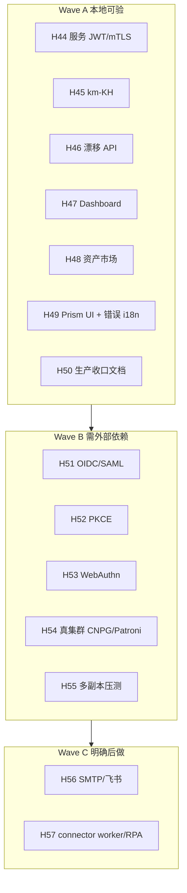

# 生产深度与体验收口 — 执行清单（H44+）

依据 [architecture.md](../architecture.md) 与架构缺口分析。  
**原则**：每片可本地验收（pytest / 控制台 typecheck）；真集群 / 真 IdP 标为 Wave B，本机以文档+骨架+skip 测例收口，不阻塞 Wave A。

进度同步：[milestones.md](milestones.md)、[handoff.md](handoff.md) §7。  
切片节奏：代码 → 测试 → OpenAPI（若有路由）→ milestones →（你确认后）单独提交。



---

## Wave A — 本回合实现

### H44 服务间短期 JWT + 可选 mTLS

| 项 | 内容 |
| --- | --- |
| 目标 | 控制面↔数据面不再仅依赖长寿命共享令牌；dev 仍可回退静态令牌 |
| 代码 | `libs/serviceauth.py`：签发/校验 `aud=aip-internal` ES256 JWT；`require_service` 双路径；可选 `AIP_SERVICE_MTLS_CA_PEM` 校验客户端证书 |
| Settings | `service_token_ttl_s`、`service_auth_mode=static\|jwt\|both`、`service_mtls_ca_pem` |
| 测例 | `tests/test_h44_service_auth.py` |
| 验收 | `pytest -q tests/test_h44_service_auth.py` |
| 不做 | 强制生产关掉 static（文档要求 prod 用 jwt/both）；真实集群 sidecar mTLS 终止 |

### H45 高棉语 km-KH

| 项 | 内容 |
| --- | --- |
| 目标 | 控制台第四语言（架构约束：中/越/高棉/英） |
| 代码 | `locales/km-KH.ts`、`i18n.ts` LANGS；关键导航/登录/帮助优先高棉文，其余可先英文占位并在 milestones 注明渐进 |
| 测例 | `i18n.test.tsx` 覆盖 km-KH 键齐全 |
| 验收 | `cd console && npm test`（i18n） |
| 不做 | 后端错误消息全量高棉；法律文书级译审 |

### H46 契约漂移运维 API

| 项 | 内容 |
| --- | --- |
| 目标 | 运维可列出/查看/清除活跃 `contract_drift`（已有表与 `list_drifts`） |
| 代码 | `GET/POST …/drifts`（platform_admin / asset_developer）；OpenAPI；控制台 Risk 或独立薄表 |
| 测例 | `tests/test_h46_drift_ops.py` |
| 验收 | pytest + 契约路由 |
| 不做 | 漂移自动回退 Suspended |

### H47 运营 Dashboard 最小只读

| 项 | 内容 |
| --- | --- |
| 目标 | 一页看待办数、活跃漂移、近期风险事件、用量摘要 |
| 代码 | `GET /api/v1/console/ops-summary`；控制台「运营概览」页 |
| 测例 | `tests/test_h47_ops_dashboard.py` + 控制台冒烟（可选） |
| 验收 | pytest；`npm run typecheck` |
| 不做 | 实时大屏、跨公司 BI |

### H48 资产市场页（消费目录）

| 项 | 内容 |
| --- | --- |
| 目标 | 与运维「资产目录」区分：面向消费方可见能力的浏览/搜索（复用 catalog / search_text） |
| 代码 | 控制台新节「资产市场」；只读；角色含 company_admin / data_owner / asset_developer |
| 测例 | 组件或 API 冒烟 |
| 验收 | typecheck + i18n |
| 不做 | 商店式评分/付费 |

### H49 Prism Mock UI 薄层 + 错误/状态 i18n

| 项 | 内容 |
| --- | --- |
| 目标 | 控制台可查看/打开已生成的 Prism Mock 基址；常见 Problem `code` 展示译文字 |
| 代码 | Distribution/连接页入口链到 mock URL；`errorCodes` 小字典三语+高棉 |
| 测例 | i18n 键；可选 API |
| 验收 | npm test |
| 不做 | 完整 Test Lab 回放 |

### H50 GenAI / Langfuse / WORM / CNPG 生产收口（文档+检查）

| 项 | 内容 |
| --- | --- |
| 目标 | 骨架能力有「生产形态」勾选，纳入 `prod-check` |
| 文档 | 扩 [observability.md](observability.md)、[audit-worm.md](audit-worm.md)、[pg-ha-prod.md](pg-ha-prod.md)、[production-checklist.md](production-checklist.md) |
| 代码 | `prod_check` 增章节；可选 `AIP_LANGFUSE_*` Settings 只读登记（不强制接线） |
| 测例 | `test_h42_prod_checklist` 扩展或 `test_h50_prod_depth.py` |
| 验收 | `tools/dev.py prod-check` |
| 不做 | 真装 Langfuse；真跑 PITR 恢复 |

---

## Wave B — 需 IdP / 集群（骨架优先）

| ID | 主题 | 本仓库交付 | 真环境验收 |
| --- | --- | --- | --- |
| **H51** | OIDC AuthProvider 插件 | 接口 + local stub + external_login 映射测例；ADR-0005 | 接 Keycloak/企业 IdP |
| **H52** | authorization_code + PKCE | 授权端点骨架 + 测例 | 浏览器联调 |
| **H53** | WebAuthn（可选第二因子） | 表结构/注册挑战骨架 | 真密钥器 |
| **H54** | CNPG/Patroni/PITR 实装 | 手册步骤 + 可选 `kind`/`k3d` 脚本（无集群则 skip） | staging 集群 |
| **H55** | 多副本真实压测 | [slo.md](slo.md) 结果表模板 + loadtest 参数文档 | k8s 4 副本实测 |

---

## Wave C — 骨架收口（真环境另验）

| ID | 主题 | 本仓库交付 | 真环境 |
| --- | --- | --- | --- |
| **H56** | SMTP / 飞书 | `SmtpMailChannel` + `FeishuChannel` + Settings | 生产 SMTP / 飞书签名 |
| **H57** | Connector worker / RPA | `connector_worker` inline\|rpc 骨架 + 文档 | 真 RPC 池；RPA 不做首期 |
| **H58** | pgvector / 成本分摊 / 双机房 | [wave-c-backlog.md](wave-c-backlog.md) + prod-check | 装扩展 / 报表 / 双活 |

---

## Wave A 总验收

```text
.venv/Scripts/python tools/dev.py lint
.venv/Scripts/python -m pytest -q tests/test_h44_service_auth.py tests/test_h46_drift_ops.py tests/test_h47_ops_dashboard.py tests/test_h42_prod_checklist.py tests/test_h50_prod_depth.py
.venv/Scripts/python tools/dev.py prod-check
cd console && npm run typecheck && npm test
```

milestones 增加 H44–H55 节；handoff §7 指向本文（Wave A/B 骨架已完成）。

---

## 状态

| ID | 状态 |
| --- | --- |
| H44 | **完成** |
| H45 | **完成** |
| H46 | **完成** |
| H47 | **完成** |
| H48 | **完成** |
| H49 | **完成** |
| H50 | **完成** |
| H51 | **完成**（骨架；真 IdP 联调另验） |
| H52 | **完成**（骨架；浏览器同意页另验） |
| H53 | **完成**（骨架；真密钥器另验） |
| H54 | **完成**（手册+冒烟脚本；无集群 skip） |
| H55 | **完成**（slo §10 结果表模板） |
| H56 | **完成**（骨架；生产 SMTP/飞书另验） |
| H57 | **完成**（骨架；真 RPC / RPA 另验） |
| H58 | **完成**（文档 + prod-check） |
