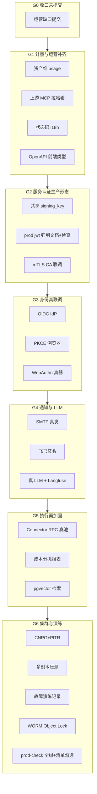

# 企业级上线总计划（Enterprise Go-Live）

> **For agentic workers:** REQUIRED SUB-SKILL: Use superpowers:subagent-driven-development (recommended) or superpowers:executing-plans to implement this plan task-by-task. Steps use checkbox (`- [ ]`) syntax for tracking.

**Goal:** 按企业级标准完成全部剩余能力与真环境验收，使平台达到可生产上线状态（对照 `docs/ops/production-checklist.md` 全勾）。

**Architecture:** 设计唯一依据 `docs/architecture.md`；模块化单体 + 独立数据面；身份仅 IAM；出站仅 `libs/httpclient`；退役/弃用见 §7.4；服务间认证见 §3.3。Wave 骨架（H44–H58）已齐，本计划补「真实现 / 真联调 / 真演练」，并纳入此前标注「不在本片」的运营与治理缺口。

**Tech Stack:** Python 3.12 / FastAPI / SQLAlchemy async / Alembic / pytest；console React+AntD；kustomize / CNPG；OpenBao Transit；OTel；Playwright e2e。

**Spec:** `docs/architecture.md`；`docs/ops/production-checklist.md`；`docs/ops/task.md`；`docs/ops/fault-drills.md`；`docs/ops/slo.md`；`docs/ops/pg-ha-prod.md`；`docs/ops/connector-worker.md`；ADR-0005 / 0014 / 0025 / 0027。

## Global Constraints

- 每个切片：迁移（若有）→ 服务 → API → 测例 → `tools/gen_openapi.py` → milestones → **单独提交**（用户确认后）。
- 提交前门禁：`tools/dev.py lint`、`tools/dev.py test`、console `typecheck && test && build`、相关 SDK 门禁。
- 新表：`company_id` + RLS + `aip_app` 授权 + `tests/iam_seed.py` truncate。
- 错误码仅用已登记值；控制台文案 `t("…")` + en-US / vi-VN / km-KH。
- Windows：`PYTHONIOENCODING=utf-8`；长脚本落文件。
- **架构明确「首期不做」项**（RPA、分公司 `company/{code}` 发布、数据出境报表、低代码画布、微服务拆分）不擅自实现：列入 **Wave X（需先改 ADR）**，执行前必须提问并获确认后再开 ADR。

## Review Focus

- 生产 `service_auth_mode=jwt` 时两端必须共享签名密钥，否则控制面↔数据面再度 401 踢会话。
- 退役「调用量归零」必须以资产/版本维计量，不能只靠 `grant.last_used_at`。
- OIDC / PKCE 不得从外部 token 信任组织声明（architecture §身份主权）。
- SMTP/飞书密钥只进 Secret/OpenBao，测例不得打印明文。
- 故障演练「停审计库」须验证 spool 不丢与恢复后哈希链连续。

## 总览（执行顺序，禁止跳过）



| Wave | 目标 | 出口标准 |
| --- | --- | --- |
| **G0** | 提交已实现运营缺口 | git 干净；测例绿；milestones 已记 |
| **G1** | 本地可验功能补齐 | pytest + console i18n/typecheck |
| **G2** | 服务间认证达生产形态 | compose 双进程 jwt 互通；prod-check |
| **G3** | 企业身份联调 | staging IdP / 浏览器 / 密钥器实测记录 |
| **G4** | 通知与 GenAI 生产接通 | 真邮件/飞书/模型调用证据 |
| **G5** | 执行与检索企业能力 | RPC 池冒烟；分摊 API；向量检索测例 |
| **G6** | 集群、压测、演练、清单 | production-checklist **全部勾选** |

---

## Wave G0 — 提交运营缺口（已实现）

### Task G0.1: 提交运营缺口切片

**Files:** 当前未提交的 registry/conn/console/serviceauth/todo/App/tests/docs/openapi 变更（不含 `.tmp`、`dist`、凭据）。

- [ ] **Step 1:** `git status` / `git diff` 确认无密钥文件
- [ ] **Step 2:** 跑 `tools/dev.py lint`、相关 pytest、console `typecheck && test`
- [ ] **Step 3:** 用户确认后按切片单独提交（建议 2–3 个 commit：lifecycle / upstream-mcp / session-auth）
- [ ] **Step 4:** 更新 `handoff.md` §7「待提交」→「已提交」

---

## Wave G1 — 计量与运营补齐

### Task G1.1: 资产/版本维调用计量 + 退役精确门禁

**Files:**
- Modify: `src/aip/data_plane/quota.py`（或新建 `meter.py`）
- Modify: `src/aip/data_plane/runtime.py`（成功调用后记 `asset:{asset_id}:version:{version_id}`）
- Modify: `src/aip/control_plane/registry/service.py` `retire_version`
- Test: `tests/test_ops_lifecycle_delete.py`（增补 usage 阻塞退役）
- Docs: `docs/architecture.md` §7.4 若需一句「计量键」说明则先提问

**Interfaces:**
- Produces: `async def recent_asset_version_calls(conn, asset_id, version_id, *, since: datetime) -> int`
- Consumes: 现有 `exec.usage_counter (day, key, company_id, count)`

- [x] **Step 1:** 写失败测例：`test_retire_blocked_when_usage_counter_recent`（插入近 30 日 `asset:…:version:…` 计数 >0 → 非 force 退役 PRECONDITION_FAILED）
- [x] **Step 2:** pytest 确认失败
- [x] **Step 3:** Runtime 成功路径写计量键；`retire_version` 查 sum(count) since cutoff；保留 grant.last_used_at 作为并列条件（任一命中即拦）
- [x] **Step 4:** pytest 通过；更新 milestones
- [x] **Step 5:** Commit（用户确认后）

### Task G1.2: 上游 MCP 在线 tools/list 拉哈希 + 一键登记

**Files:**
- Modify: `src/aip/control_plane/conn/service.py` / `api.py`
- Modify: `console/src/pages/Connections.tsx`
- Test: `tests/test_m7_upstream_mcp.py` 或新建 `tests/test_upstream_mcp_source_ops.py`
- OpenAPI: `tools/gen_openapi.py`

**Interfaces:**
- Produces: `POST /api/v1/upstream-mcp-sources/preview-hash` → `{ tools_manifest_hash, tools }`
- Consumes: 系统连接 + `libs/httpclient.build_client`

- [x] **Step 1:** 失败测例：对 FakeUpstream `preview-hash` 返回稳定 hash
- [x] **Step 2:** 实现 preview（出站经 httpclient；沙箱拒 live 写无关）
- [x] **Step 3:** 控制台登记表单「从连接拉取哈希」按钮
- [x] **Step 4:** i18n + pytest + typecheck
- [x] **Step 5:** Commit

### Task G1.3: 控制台状态码 / 连接状态多语言映射

**Files:**
- Modify: `console/src/locales/{en-US,vi-VN,km-KH}.ts`
- Modify: `console/src/components.tsx` `StateTag` 或统一 `statusLabel()`
- Test: `console/src/i18n.test.tsx`（键齐全）

- [x] **Step 1:** 枚举源码中未映射的 status（含 `pending_approval`）
- [x] **Step 2:** 补译文；`StateTag` 对已知态走 `t()`
- [x] **Step 3:** `npm test` i18n 通过
- [x] **Step 4:** Commit

### Task G1.4: 控制台类型从 OpenAPI 生成（最小可用）

**Files:**
- Create: `console/scripts/gen-api-types.mjs`（或 openapi-typescript）
- Modify: `console/package.json` script `gen:api`
- Modify: 逐步替换 `src/types.ts` 中与 OpenAPI 重合的接口（首批：Connection / UpstreamMcpSource / Asset 列表）
- Test: `npm run typecheck`

- [x] **Step 1:** 接入生成器，输出 `src/api-types.generated.ts`
- [x] **Step 2:** 手工类型改为 re-export / 交叉，保证 build
- [x] **Step 3:** CI 或 `tools/dev.py docs` 说明生成物需提交
- [x] **Step 4:** Commit

---

## Wave G2 — 服务认证生产形态

### Task G2.1: 开发/ staging 共享 signing_key_pem

**Files:**
- Modify: `tools/dev.py` / compose env：生成或挂载共享 EC 私钥
- Modify: `docs/ops/k8s.md`、`production-checklist.md` Secrets 节
- Test: `tests/test_h44_service_auth.py` 增「双 Settings 同 pem 互通」

- [x] **Step 1:** 测例：进程 A mint、进程 B verify（同 pem）
- [x] **Step 2:** `dev.py serve` 双进程使用同一 `AIP_SIGNING_KEY_PEM`
- [x] **Step 3:** 手工：`GET /todo` 在 jwt 模式下 200（由共享 PEM + jwt 测例覆盖；serve 打印 shared_signing_kid）
- [x] **Step 4:** Commit

### Task G2.2: prod-check 强制生产 jwt + 禁 dev 默认

**Files:**
- Modify: `src/aip/libs/prod_check.py`
- Test: `tests/test_h42_prod_checklist.py` / `test_h50_prod_depth.py`

- [x] **Step 1:** `AIP_ENV=prod` 且 `service_auth_mode=static` → prod-check 失败
- [x] **Step 2:** 缺 `signing_key_pem` / Transit 配置 → 失败
- [x] **Step 3:** 文档勾选说明；Commit

### Task G2.3: service mTLS CA 路径联调说明 + 可选 compose

**Files:**
- Modify: `docs/ops/` 增短节或扩 k8s.md
- Optional: `deploy/docker-compose.mtls-smoke.yml`
- Test: 已有 `test_h44` mTLS 单测；增 skip 标记的集成冒烟

- [x] **Step 1:** 文档步骤可复现
- [x] **Step 2:** 有证书夹具时 pytest 通过
- [x] **Step 3:** Commit

---

## Wave G3 — 企业身份真联调

### Task G3.1: OIDC AuthProvider 接真实 IdP（Keycloak 或集团）

**Files:**
- Modify: `src/aip/control_plane/iam/external_login.py` 及 OIDC 插件实现
- Create: `docs/ops/oidc-staging.md`（realm、client、redirect、映射表）
- Test: `tests/test_h51_*.py` 扩；staging 手工清单

**Interfaces:**
- 外部 id_token / userinfo → **仅**映射到已有 `iam_user`；禁止信任外部 org/role claim 写入授权

- [x] **Step 1:** staging Keycloak（或提供的 IdP）创建 client（运维清单见 oidc-staging.md）
- [x] **Step 2:** 代码走通 JWKS 校验 id_token → external_login → 会话（code 交换可由 BFF；测例用本地 JWKS）
- [x] **Step 3:** 测例 + 手工登录截图/日志（脱敏）归档 `.aip-data/staging-evidence/`（不入库密钥）
- [x] **Step 4:** milestones；Commit

### Task G3.2: PKCE 浏览器同意页联调

**Files:**
- Modify: 现有 PKCE 端点 + 最小同意页（控制台或静态）
- Test: Playwright 或脚本走完 code+pkce → token
- Docs: `docs/ops/pkce-staging.md`

- [x] **Step 1:** 浏览器完整授权码流成功
- [x] **Step 2:** 重放 code 失败；缺 code_verifier 失败
- [x] **Step 3:** Commit

### Task G3.3: WebAuthn 真密钥器注册/登录

**Files:**
- Modify: `src/aip/control_plane/iam/webauthn.py` + 控制台绑定 UI
- Test: 真器手工 + 虚拟 authenticator e2e（Playwright）

- [x] **Step 1:** 注册 → 登录挑战成功
- [x] **Step 2:** sign_count 重放拒绝
- [x] **Step 3:** Commit

---

## Wave G4 — 通知与 LLM 生产接通

### Task G4.1: 生产 SMTP 连通

**Files:**
- Modify: Settings / Secret 注入文档
- Test: `tests/test_h56_smtp_feishu.py` 增 `@pytest.mark.smtp` 真发（需 `AIP_TEST_SMTP_*`）
- Evidence: 收件箱证明（脱敏）

- [x] **Step 1:** staging SMTP 发一封平台告警样例（`-m smtp` 真发；无密钥 skip）
- [x] **Step 2:** 失败重试与无密码泄漏日志检查
- [x] **Step 3:** production-checklist SMTP 勾选；Commit 文档/测例

### Task G4.2: 飞书 Webhook（签名校验策略）

**Files:**
- Modify: `src/aip/libs/notify/` FeishuChannel（若缺签名则按飞书文档补）
- Test: mark `feishu` 真推

- [x] **Step 1:** 真机器人收到文本（`-m feishu`；无 URL skip）
- [x] **Step 2:** 错误 URL 不导致请求线程崩溃
- [x] **Step 3:** Commit

### Task G4.3: 真 LLM + 可选 Langfuse

**Files:**
- Modify: `src/aip/control_plane/llm/` provider 配置；白名单生产模型
- Docs: `observability.md` Langfuse 接线步骤
- Test: mark `llm` 真调用；无密钥 skip

- [x] **Step 1:** Gateway GenAI span + `-m llm` 真调用夹具（无密钥 skip）；提供方 API 已支持兼容端点
- [x] **Step 2:** 预算/脱敏仍生效的测例（`test_budget_and_redact_still_gate_before_upstream`）
- [x] **Step 3:** `observability.md` Langfuse 经 Collector OTLP 接线步骤；Commit

---

## Wave G5 — 执行面与检索

### Task G5.1: Connector worker 真 RPC 池

**Files:**
- Modify: `src/aip/libs/connector_worker.py`；数据面调度
- Create: worker 进程入口；kustomize Deployment 草稿
- Test: `tests/test_h57_*.py` 进程间 invoke 冒烟
- Docs: `connector-worker.md` 去掉「真 RPC 未接线」

- [x] **Step 1:** `mode=rpc` 下经 HTTP JSON 调用 worker 返回（`test_rpc_execute_roundtrip`）
- [x] **Step 2:** worker 挂掉 → `DOWNSTREAM_UNAVAILABLE`（非悬挂）
- [x] **Step 3:** Commit

### Task G5.2: 成本分摊报表 API + 控制台只读页

**Files:**
- Create: `src/aip/control_plane/billing/` 或 `risk` 下 `usage_report`
- API: `GET /api/v1/console/usage-report?from=&to=&group_by=consumer|company|asset`
- Console: 运营概览或独立节
- Test: 灌 `usage_counter` 后聚合正确

- [ ] **Step 1:** 失败测例定聚合规则（与 architecture 计量一致）
- [ ] **Step 2:** 实现 + OpenAPI + UI + i18n
- [ ] **Step 3:** Commit

### Task G5.3: pgvector 语义检索

**Files:**
- Migration opt-in（类似 zhparser）；`docs/ops/search-index.md`
- Modify: discovery / catalog `q=` 路径双通道（FTS + vector）
- Test: mark `pgvector`；无扩展 skip；有扩展插入 embedding 可搜到

- [ ] **Step 1:** Dockerfile/compose override 可启 pgvector
- [ ] **Step 2:** 写入与查询测例
- [ ] **Step 3:** Commit

---

## Wave G6 — 集群、压测、演练、清单全绿

### Task G6.1: staging CNPG + PITR 恢复演练

**Files:** `docs/ops/pg-ha-prod.md` 实操记录模板；脚本 `tools/cnpg_kind_smoke.py` 扩展或 staging runbook

- [ ] **Step 1:** staging 安装 CNPG，应用连上读写服务
- [ ] **Step 2:** 造数 → 备份 → 销毁 → PITR 恢复 → 数据校验
- [ ] **Step 3:** 记录写入 milestones / 证据目录；勾选 checklist

### Task G6.2: k8s 多副本压测写入 slo

**Files:** `docs/ops/slo.md` §10；`tools/loadtest.py`

- [ ] **Step 1:** 4 副本控制面/数据面压测
- [ ] **Step 2:** 延迟/错误率填入 slo 表
- [ ] **Step 3:** 不达标则修扩容/配额后再测（禁止带红线上生产）

### Task G6.3: 故障演练四件套实记

**Files:** `docs/ops/fault-drills.md` 填表

- [ ] **Step 1:** 停控制面 / Valkey / OpenBao / 审计库各一次
- [ ] **Step 2:** 行为符合 12.2；审计 spool 零丢失验证
- [ ] **Step 3:** 签字/日期归档

### Task G6.4: WORM Object Lock 全量

**Files:** 桶策略；`audit-worm.md`；测例或运维脚本校验 put_if_absent

- [ ] **Step 1:** 桶合规模式 + 保留期
- [ ] **Step 2:** 锚点写入与篡改拒绝验证
- [ ] **Step 3:** 勾选 checklist

### Task G6.5: 生产清单收口 + prod-check

**Files:** `docs/ops/production-checklist.md`（全部 `[x]`）；`handoff.md` 宣布可上线

- [ ] **Step 1:** `tools/dev.py prod-check` 绿
- [ ] **Step 2:** 人工逐项勾选 Secrets → 双机房策略说明
- [ ] **Step 3:** 发布 go-live 记录（版本、镜像 tag、演练日期）

### Task G6.6: 双机房 / 跨机架（集团策略落地）

**Files:** 部署拓扑文档；kustomize overlays（region-a / region-b）；流量与数据驻留说明（**不做**跨境报表，见 ADR-0025）

- [ ] **Step 1:** 与集团确认拓扑与 RPO/RTO
- [ ] **Step 2:** overlay + 演练切换
- [ ] **Step 3:** 勾选 checklist「双机房」

---

## Wave X — 需先改 ADR（默认不实施）

| 项 | 架构现状 | 若要坚持做 |
| --- | --- | --- |
| RPA / 浏览器自动化连接器 | §9.1「首期不做」 | 新 ADR 推翻后再开 Wave |
| 分公司 `company/{code}` 命名空间发布 | §10.4「预留，首期不开放」 | 新 ADR |
| 数据出境/驻留报表 | ADR-0025 平台不做 | 不在平台范围 |
| 低代码画布 / 微服务拆分 | 非目标 | 不在范围 |

执行到 Wave X 前 **必须停下来提问**。

---

## 每片通用验收命令

```text
.venv/Scripts/python tools/dev.py lint
.venv/Scripts/python -m pytest -q <本片测例>
cd console && npm run typecheck && npm test
# 若改 OpenAPI：
.venv/Scripts/python tools/gen_openapi.py
# 上线前总闸：
.venv/Scripts/python tools/dev.py prod-check
cd console && npx playwright test e2e/console.spec.ts
```

## Self-Review（覆盖对照）

| 来源要求 | 任务 |
| --- | --- |
| production-checklist Secrets/迁移/kustomize | G2 / G6 |
| CNPG / PITR | G6.1 |
| OpenBao/Valkey/OPA/S3 | G6 + 运维勾选 |
| OTel / Langfuse | G4.3 |
| WORM Object Lock | G6.4 |
| SMTP / 飞书 | G4.1–G4.2 |
| 服务 jwt / mTLS | G2 |
| OIDC / PKCE / WebAuthn | G3 |
| Connector worker | G5.1 |
| pgvector / 分摊 / 双机房 | G5.2–G5.3 / G6.6 |
| 退役精确计量 | G1.1 |
| 上游 MCP 拉哈希 | G1.2 |
| 状态 i18n / OpenAPI 类型 | G1.3–G1.4 |
| 故障演练 / 多副本压测 | G6.2–G6.3 |
| 运营缺口已实现 | G0 |

---

## 进度同步

- 主清单：本文勾选
- 运维入口：更新 `docs/ops/task.md` 增加 **Wave G**，指向本文
- 交接：`docs/ops/handoff.md` §7 当前下一步 = Wave G0 → G6
